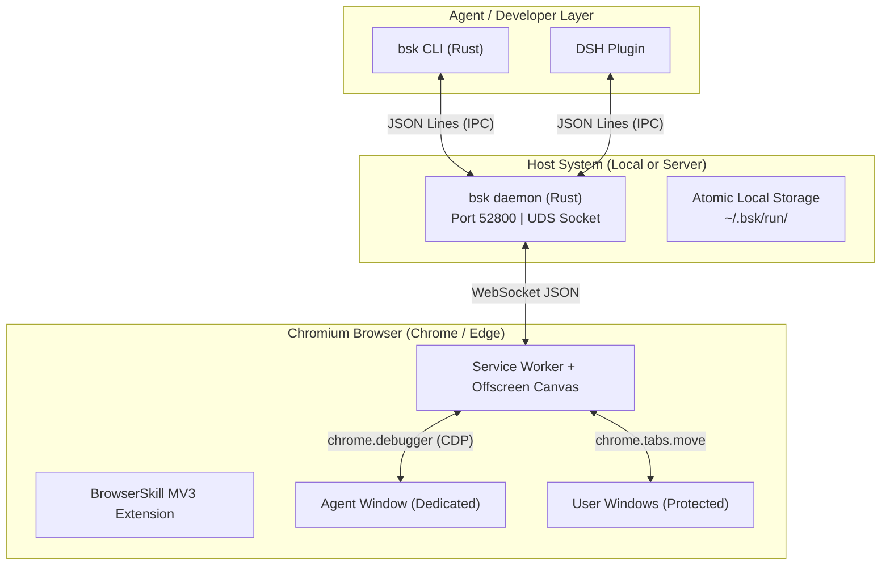
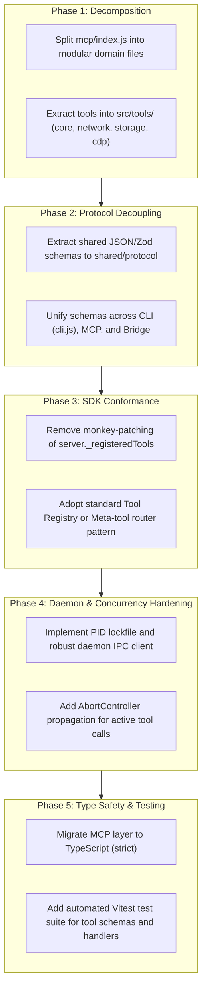

# BrowserSkill (bsk) vs browserctl MCP: Architecture Comparison and Enhancement Plan

This document provides a comprehensive, function-by-function comparison between Tencent's **BrowserSkill (`bsk`)** and `browserctl`'s MCP server/extension architecture. It analyzes the mechanics, invariants, and implementation differences of each tool to guide the enhancement of `browserctl`'s automation layer while preserving `browserctl`'s token efficiency and deterministic execution model.

---

## 1. Architectural Foundation and Core Invariants

BrowserSkill operates across three tiers:
1. **Agent Harness / CLI (`crates/bsk-cli`)**: Rust-based CLI binary handling parameter parsing, subshell execution, and atomic disk writes.
2. **Background Daemon (`crates/bsk-cli/src/daemon`)**: A local or server-mode process listening on loopback WebSocket (default port `52800`) and Unix Domain Socket (UDS) / Windows Named Pipes (`~/.bsk/run/daemon.sock`). Enforces serial request queues per session, tracks connected browsers, manages device grants for remote connections, and gates commands against user interrupts.
3. **MV3 Browser Extension (`apps/extension`)**: Built with WXT, React, and TypeScript. Implements CDP driving (`chrome.debugger`), WebExtensions API calls (`chrome.tabs`, `chrome.windows`, `chrome.downloads`), content script overlays, DOM VOM parsing, and offscreen media encoding.



### Key Architectural Invariants

1. **Untrusted Page Content Boundary**: Page text, attributes, accessibility trees, and responses are treated strictly as data, never instructions. The agent prompt explicitly guards against prompt injection from scraped web content.
2. **Agent Window & Tab Borrowing Isolation**: By default, mutations are strictly confined to a dedicated **Agent Window**. Interacting with user tabs requires an explicit `tab_borrow` operation (moving the tab into the Agent Window, presenting an in-browser confirmation dialog if configured), which is returned to the user window upon `session_stop`.
3. **HoverLatch Lifecycle**: Standard automation drops hover states upon subsequent actions. BrowserSkill maintains a `HoverLatch` map `(sessionId, tabId, x, y)`. When an observation (`observe` or `snapshot`) runs, it automatically reasserts hover at those coordinates. Subsequent mutating actions (`click`, `fill`, `navigate`) release the latch.
4. **Cancellation and Interrupt Chain**: Every tool execution registers an `AbortController` in `ToolDispatcher.inflightAbortControllers`. If the user clicks the Stop button on the in-page control overlay or the daemon cancels the RPC, the controller aborts in-flight CDP commands without leaving dangling browser state.
5. **Path Boundary for File Transfers**: Absolute file paths on the agent host are never sent to the browser extension. The CLI/daemon stages upload files into private session storage and streams download bytes via atomic temporary files.

---

## 2. Exhaustive Method and Tool Specifications

---

### Category I: System and Daemon Lifecycle

#### 1. `system.handshake` (Wire RPC)
- **Purpose**: Negotiates protocol compatibility between extension, daemon, and CLI during initial WebSocket establishment.
- **Parameters**:
  - `version: string`: Extension version string (e.g., `"0.9.0"`).
  - `browser_instance_id: string`: Unique UUID assigned to the browser profile.
  - `browser_label?: string`: Optional human-readable name for the profile.
  - `platform?: string`: Operating system identifier.
- **Execution Mechanism**:
  - Sent by the extension immediately upon establishing WebSocket connection to `ws://127.0.0.1:52800`.
  - The daemon validates the version against minimum compatibility constraints in `bsk-protocol`.
  - Rejects connections with mismatched protocol majors; stores browser metadata in `daemon.browsers`.
- **Return Value**: `{ status: "ok", daemon_version: string, connection_id: string }`.
- **Comparison with browserctl**: `browserctl` establishes connection between bridge daemon (port `8765`) and extension via WebSocket without requiring an explicit cryptographic handshake, relying instead on loopback origin checks. BrowserSkill's handshake supports remote server pairing and token negotiation.

#### 2. `system.ping` / `system.status` (Wire RPC & CLI: `bsk status`)
- **Purpose**: Heartbeat and diagnostic inspection of daemon, connected browsers, and active sessions.
- **Parameters**: None.
- **Execution Mechanism**:
  - CLI queries daemon via IPC socket (`get_status`).
  - Daemon reads advisory lock file `~/.bsk/daemon.lock`, reads `daemon.json`, and queries in-memory maps of connected WebSocket clients and active sessions.
- **Return Value**:
  ```json
  {
    "daemon": { "pid": 1234, "port": 52800, "uptime_secs": 3600, "mode": "local" },
    "browsers": [
      { "instance_id": "b-uuid", "label": "Default", "connected": true, "tabs_count": 5 }
    ],
    "sessions": [
      { "session_id": "a1b2", "browser_id": "b-uuid", "window_id": 987, "idle_secs": 12 }
    ]
  }
  ```
- **Comparison with browserctl**: Corresponds to `browserctl status`. `browserctl` reports bridge reachability, Chrome extension connection state, and current selected tab ID.

#### 3. `daemon.start` / `stop` / `restart` (CLI Commands)
- **Purpose**: Daemon lifecycle management.
- **Parameters**:
  - `--mode <local|server>`: Local loopback or authenticated remote server.
  - `--port <u16>`: WebSocket port (default: `52800`).
  - `--foreground`: Runs attached to terminal instead of background daemonizing.
  - `--tls-cert <path>`, `--tls-key <path>`: Required for non-loopback server mode.
  - `--session-idle <duration>`, `--daemon-idle <duration>`: Automatic teardown timers (default: 5 min session, 10 min daemon).
- **Execution Mechanism**:
  - Unix: Forks process, writes PID to `~/.bsk/daemon.pid`, acquires flock on `daemon.lock`.
  - Windows: Creates process with detached flags, renames executable safely on updates using NTFS stream rename capabilities.
- **Comparison with browserctl**: `browserctl` auto-spawns its Node.js bridge daemon on demand when `bctl` or MCP connects to port `8765`.

#### 4. `daemon.pair` / `devices` / `revoke` (CLI Commands)
- **Purpose**: Authenticated device authorization for remote extension pairing.
- **Execution Mechanism**:
  - `pair`: Generates a short-lived cryptographic pairing URL with a one-time token (`ttl: 5m`). The user opens this URL in their browser extension to authorize a remote agent.
  - `devices`: Lists active paired device IDs stored in `~/.bsk/devices.json`.
  - `revoke`: Invalidates session grants for a given device or `--all`.
- **Comparison with browserctl**: `browserctl` currently assumes local execution. Adding remote pairing enables cloud-hosted agent environments (Docker/cloud VM) to drive a local developer browser securely over WSS.

#### 5. `doctor` (CLI: `bsk doctor`)
- **Purpose**: Comprehensive environment diagnostics and self-repair hints.
- **Execution Mechanism**:
  - Verifies presence and permissions of `$BSK_HOME`, IPC sockets, lockfiles, Chromium extension store installation status, and auto-update transaction state (`update-state.json`).

---

### Category II: Session Lifecycle and Window Management

#### 6. `session.start` (Wire: `session.start` / `tool.session_start` | CLI: `bsk session start`)
- **Purpose**: Allocates a task session, assigns an opaque 4-character ID, and launches a dedicated **Agent Window**.
- **Parameters**:
  - `browser?: string`: Target browser instance or label.
  - `name?: string`: Human-readable task name shown in extension UI.
  - `incognito?: boolean`: Opens an incognito Agent Window (requires extension setting permission).
  - `width?: u32`, `height?: u32`: Outer window dimensions in CSS pixels (bounds: `100..=7680`).
  - `focus?: boolean` / `no_focus?: boolean`: Whether to bring the new window to foreground (default: background).
- **Execution Mechanism**:
  1. Daemon checks lock, allocates session ID, and serializes tool queue.
  2. Forwards `tool.session_start` to extension over WebSocket.
  3. Extension executes `chrome.windows.create({ focused: params.focus ?? false, incognito, width, height })`.
  4. Stores `SessionContext` with an isolated `RefStore`, borrowed tab map, and in-page control overlay state.
  5. Injects the control overlay into the initial tab (`chrome://newtab` or about:blank) via content script.
- **Return Value**: `{ session_id: "ab12", window_id: 1234, active_tab_id: 5678 }`.
- **Comparison with browserctl**: `browserctl` currently does not enforce an Agent Window boundary—it acts directly on tabs within the user's active window or opens tabs via `tabs({ action: "open" })`. Adopting an optional Agent Window mode provides user isolation.

#### 7. `session.stop` (Wire: `session.stop` / `tool.session_stop` | CLI: `bsk session stop`)
- **Purpose**: Graceful teardown of a session and full restoration of browser state.
- **Parameters**:
  - `session_id: string`: Active session ID.
- **Execution Mechanism**:
  1. Stops active video recordings (`this.video.stopSession`).
  2. Stops website debugging sessions and flushes trace logs.
  3. Releases any held screenshot export buffers and hover latches.
  4. **Tab Restoration**: Iterates all borrowed tabs, calls `chrome.tabs.move` to return each tab to its `original_window_id` and `original_index`, and detaches debugger sessions.
  5. Closes the Agent Window via `chrome.windows.remove(agentWindowId)`.
  6. Releases daemon-side staged transfer directories.
- **Return Value**: `{ status: "stopped", returned_tabs: [number] }`.
- **Comparison with browserctl**: `browserctl stop` terminates the local bridge daemon. `browserctl` lacks session-scoped tab cleanup because it does not maintain session isolation boundaries.

#### 8. `tool.window_resize` (CLI: `bsk window resize`)
- **Purpose**: Dynamically adjusts the outer dimensions of the Agent Window.
- **Parameters**:
  - `session_id: string`: Active session.
  - `width: u32`, `height: u32`: Bounds `100..=7680`.
- **Execution Mechanism**: Calls `chrome.windows.update(ctx.agentWindowId, { width, height })`.
- **Return Value**: `{ window_id: number, width: number, height: number }`.

---

### Category III: Tab Governance and Borrowing

#### 9. `tool.tab_list` (CLI: `bsk tab list`)
- **Purpose**: Queries open tabs with visibility filtering based on session isolation.
- **Parameters**:
  - `session_id: string`: Active session.
  - `scope: "user" | "agent" | "all"`:
    - `"agent"`: Only tabs inside this session's Agent Window.
    - `"user"`: Tabs in user windows (excluding other concurrent agents' windows).
    - `"all"`: Union of `agent` and `user` tabs.
- **Execution Mechanism**:
  1. Queries all tabs via `chrome.tabs.query({})`.
  2. Filters out tabs belonging to other active agent sessions to enforce cross-session privacy.
  3. Annotates each tab with `scope: "user"` or `scope: "agent"`.
- **Return Value**:
  ```json
  {
    "tabs": [
      { "tab_id": 101, "title": "GitHub", "url": "https://github.com", "window_id": 10, "scope": "user" },
      { "tab_id": 202, "title": "New Tab", "url": "about:blank", "window_id": 20, "scope": "agent" }
    ]
  }
  ```
- **Comparison with browserctl**: `browserctl tabs({ action: "list" })` lists tabs across all connected browser windows without differentiating ownership scopes.

#### 10. `tool.tab_create` (CLI: `bsk tab create`)
- **Purpose**: Creates a new tab strictly inside the session's Agent Window.
- **Parameters**:
  - `session_id: string`: Active session.
  - `url?: string`: Destination URL (default: `chrome://newtab/`).
  - `active?: boolean`: Whether to activate/focus the tab (default: `true`).
  - `index?: i32`: Index in the tab strip.
- **Execution Mechanism**: Calls `chrome.tabs.create({ windowId: ctx.agentWindowId, url, active, index })`. Automatically registers the tab ID in `ctx.agentControlledTabs`.
- **Return Value**: `{ tab_id: number, window_id: number, url: string }`.

#### 11. `tool.tab_close` (CLI: `bsk tab close`)
- **Purpose**: Closes a tab owned by the Agent Window.
- **Parameters**:
  - `session_id: string`, `tab_id: number`.
- **Execution Mechanism**: Rejects requests targeting user tabs with `permission_denied: agent_window_scope`. Calls `chrome.tabs.remove(tabId)`. If closing the last tab in the window, handles window preservation or recreation.

#### 12. `tool.tab_select` (CLI: `bsk tab select`)
- **Purpose**: Activates a tab inside the Agent Window.
- **Parameters**: `session_id: string`, `tab_id: number`.
- **Execution Mechanism**: Calls `chrome.tabs.update(tabId, { active: true })`.

#### 13. `tool.tab_borrow` (CLI: `bsk tab borrow`)
- **Purpose**: Temporarily moves a user's logged-in tab into the Agent Window for automation.
- **Parameters**:
  - `session_id: string`: Active session.
  - `tab_id: number`: User tab to borrow.
  - `confirmation_timeout_ms?: number`: Timeout waiting for user confirmation (default: `30000`).
- **Execution Mechanism**:
  1. Validates that `tab_id` is a user tab and not already borrowed.
  2. If user settings require confirmation, sends an overlay prompt to the tab: *"An AI agent wants to borrow this tab. Allow?"*
  3. Upon approval, records `{ original_window_id: tab.windowId, original_index: tab.index }`.
  4. Calls `chrome.tabs.move(tabId, { windowId: ctx.agentWindowId, index: -1 })`.
  5. Injects the agent control banner onto the tab.
- **Return Value**: `{ tab_id: number, original_window_id: number, original_index: number, agent_window_id: number }`.
- **Comparison with browserctl**: Unique to BrowserSkill. Prevents the agent from inadvertently acting on user tabs without conscious authorization.

#### 14. `tool.tab_return` (CLI: `bsk tab return`)
- **Purpose**: Restores a borrowed tab to its origin window.
- **Parameters**: `session_id: string`, `tab_id: number`.
- **Execution Mechanism**:
  1. Flushes any pending hover latches and detaches debugger sessions on `tab_id`.
  2. Calls `chrome.tabs.move(tabId, { windowId: borrowInfo.originalWindowId, index: borrowInfo.originalIndex })`.
  3. Removes the agent banner overlay.
- **Return Value**: `{ tab_id: number, restored_window_id: number, restored_index: number }`.

---

### Category IV: Navigation and Page Lifecycle

#### 15. `tool.navigate` (CLI: `bsk navigate`)
- **Purpose**: Navigates the target tab to a URL and waits for page readiness.
- **Parameters**:
  - `session_id: string`: Active session.
  - `url: string`: HTTP/HTTPS destination.
  - `tab_id?: number`: Defaults to active tab in Agent Window.
  - `timeout_ms?: number`: Navigation timeout (default: `30000`).
- **Execution Mechanism**:
  1. Enforces Agent Window ownership; releases active hover latches.
  2. Attaches CDP `Page` and `Network` domains.
  3. Calls `Page.navigate({ url })`.
  4. Waits for `Page.lifecycleEvent` corresponding to `load` or `networkAlmostIdle`, with fallback to `DOMContentLoaded`.
  5. Intercepts any JavaScript dialogs (`alert`/`confirm`) appearing during load and records them in the result.
- **Return Value**: `{ tab_id: number, url: string, status: number, dialogs?: JavaScriptDialogInfo[] }`.
- **Comparison with browserctl**: `browserctl navigate` uses `chrome.tabs.update` or `Page.navigate`, waiting for web navigation completion or `settle`. BrowserSkill pairs navigation with explicit dialog tracking and hover latch clearance.

#### 16. `tool.navigate_back` / `tool.navigate_forward` / `tool.reload` (CLI Commands)
- **Purpose**: History traversal and document reloading.
- **Execution Mechanism**: Uses `Page.getNavigationHistory` followed by `Page.navigateToHistoryEntry` or `Page.reload({ ignoreCache })`.

#### 17. `tool.wait_for_navigation` (CLI: `bsk wait-for-navigation`)
- **Purpose**: Waits for an in-flight navigation lifecycle event to reach a specific phase.
- **Parameters**:
  - `wait_until?: "load" | "domcontentloaded" | "networkidle" | "commit"` (default: `"load"`).
  - `timeout_ms?: number` (default: `30000`).
- **Execution Mechanism**: Subscribes to CDP `Page.lifecycleEvent` on the main frame (ignoring subframe events). Resolves as soon as the target phase matches.

---

### Category V: Page Observation, Accessibility and Visual Object Model (VOM)

#### 18. `tool.observe` (CLI: `bsk observe`)
- **Purpose**: Comprehensive semantic page census producing a token-optimized **Visual Object Model (VOM)** tree with perceptual discovery probes.
- **Parameters**:
  - `session_id: string`, `tab_id?: number`.
  - `probe_hover?: boolean`: Actively hovers controls during observation to detect hidden dropdowns/tooltips.
  - `max_depth?: u32`: Tree depth truncation limit.
  - `max_tokens?: u32`: Soft token budget (~4 characters per token).
  - `cursor?: string`: Continuation cursor for pagination across long documents.
  - `debug_surfaces?: boolean`: Includes surface probe diagnostics in output.
- **Execution Mechanism**:
  1. Reasserts any active hover latch via `withHoverReassert`.
  2. Calls `Accessibility.getFullAXTree` to gather baseline semantic roles, names, and states.
  3. Queries DOM layout rects via CDP `DOM.getBoxModel` and computed styles.
  4. Discovers Canvas and rich media candidates (`discoverVisualCandidates`).
  5. **Hover Probing** (if `probe_hover: true`): Coordinates temporary mouse movements across elements tagged with pointer listeners or CSS `:hover` rules to identify dynamic popovers, then restores initial pointer state.
  6. Normalizes the semantic graph into an indented structure with stable `@eN` references.
  7. Formats into the VOM markup language, respecting `max_tokens` and producing `next_cursor` if truncated.
- **Return Value**:
  ```text
  [Header]
    [@e1] link "Home" url="/home"
    [@e2] button "Menu" [collapsed]
  [Main]
    [@e3] heading "Account Dashboard" level=1
    [@e4] input:text "Search" placeholder="Search orders..."
  [Footer]
    [@e5] link "Privacy"
  ```
- **Comparison with browserctl**:
  - `browserctl snapshot` produces a compact, flat control census (`[@ref_1] <a> "Home" -> /home`) with container counts (`structure: footer 22, header 5`).
  - `bsk observe` produces a deeper hierarchical VOM with built-in hover perception probes and token-bounded cursor pagination. Both prioritize token efficiency over raw HTML.

#### 19. `tool.snapshot` (CLI: `bsk snapshot`)
- **Purpose**: Passive ARIA accessibility tree snapshot without active hover probing.
- **Parameters**: `session_id: string`, `tab_id?: number`, `cursor?: string`, `max_depth?: u32`, `max_tokens?: u32`.
- **Execution Mechanism**: Gathers `Accessibility.getFullAXTree`, skips layout probing, assigns `@eN` refs, and outputs indented accessibility hierarchy.

#### 20. `tool.get_html` (CLI: `bsk get-html`)
- **Purpose**: Retrieves raw outer HTML for the full document or a targeted element ref.
- **Parameters**: `session_id: string`, `tab_id?: number`, `ref?: string`, `selector?: string`, `max_chars?: u32`.
- **Execution Mechanism**:
  - If `ref`: Resolves backend node ID from `RefStore`, evaluates `function() { return this.outerHTML; }` via `Runtime.callFunctionOn`.
  - If no ref/selector: Calls `DOM.getDocument` followed by `DOM.getOuterHTML`.

---

### Category VI: Input Emulation and Interactions

#### 21. `tool.click` (CLI: `bsk click`)
- **Purpose**: Dispatches synthetic mouse clicks to an element, CSS selector, or visual point.
- **Parameters**:
  - `target: string` (positional: ref `@eN` or CSS selector).
  - `button?: "left" | "middle" | "right"` (default: `"left"`).
  - `click_count?: u32` (default: `1`, `2` for double-click).
  - `modifiers?: string` (comma-separated: `"ctrl,shift,alt,meta"`).
  - `timeout_ms?: number` (default: `30000`).
- **Execution Mechanism**:
  1. Resolves target via `resolveActionTarget`. Supports both top-level documents and nested OOPIF frames.
  2. Resolves node geometry (`resolveNodeGeometry`): scrolls node and ancestor frames into view using `DOM.scrollIntoViewIfNeeded`.
  3. Computes the element's visible action point `centre = { x, y }` from its live content quad.
  4. Waits for renderer input readiness (`withInputReady`): ensures paint pipeline has settled so events are not dropped.
  5. **Click Overlay & Popup Guard**: Arms `withTaskPopups` to capture new tabs spawned by `<a target="_blank">` or `window.open`, automatically attaching them to the Agent Window.
  6. Dispatches native CDP events in sequence:
     - `Input.dispatchMouseEvent({ type: "mouseMoved", x, y, modifiers })`
     - `Input.dispatchMouseEvent({ type: "mousePressed", x, y, button, clickCount, modifiers })`
     - `Input.dispatchMouseEvent({ type: "mouseReleased", x, y, button, clickCount, modifiers })`
  7. Checks `markDialogCursor` to detect if an alert/confirm was opened by the click.
  8. Releases any prior hover latch.
- **Return Value**: `{ tab_id: number, used_ref?: string, used_selector?: string, x: number, y: number, dialogs?: JavaScriptDialogInfo[] }`.
- **Comparison with browserctl**:
  - `browserctl click` returns `resolved` (matching strategy) and `effect` (`navigated`, `dom_mutated`, `no_change`).
  - BrowserSkill returns coordinate data, tracks spawned popups via `withTaskPopups`, and tracks dialogs via `attachDialogs`. BrowserSkill also supports canvas visual coordinate clicks.

#### 22. `tool.hover` (CLI: `bsk hover`)
- **Purpose**: Moves pointer over an element and latches the hover state.
- **Parameters**: `target: string` (`@eN` or CSS selector), `session_id: string`, `tab_id?: number`.
- **Execution Mechanism**:
  1. Resolves node geometry and action point `(x, y)`.
  2. Dispatches `Input.dispatchMouseEvent({ type: "mouseMoved", x, y })`.
  3. Waits `DEFAULT_HOVER_SETTLE_MS` (200ms) for CSS transitions and event listeners.
  4. **Latches the Hover**: Saves `(sessionId, tabId, x, y)` in `this.hoverLatches`.
- **Return Value**: `{ tab_id: number, used_ref?: string, used_selector?: string, x: number, y: number }`.

#### 23. `tool.wheel` (CLI: `bsk wheel`)
- **Purpose**: Dispatches native mouse wheel scroll events at an action point or viewport center.
- **Parameters**:
  - `delta_x: f64`, `delta_y: f64`: Pixel scroll distances.
  - `target?: string`: Target element to hover before scrolling.
  - `modifiers?: string`.
- **Execution Mechanism**:
  - Dispatches `Input.dispatchMouseEvent({ type: "mouseWheel", x, y, deltaX, deltaY, modifiers })`.

#### 24. `tool.scroll_to` (CLI: `bsk scroll-to`)
- **Purpose**: Smoothly or immediately scrolls an element into the visible viewport.
- **Parameters**: `target: string` (`@eN` or selector), `session_id: string`.
- **Execution Mechanism**: Calls `scrollElementAndFramesIntoView`, executing `DOM.scrollIntoViewIfNeeded` on the node across all nested iframe boundaries.

---

### Category VII: Focus, Text Input, and Form Handling

#### 25. `tool.focus` / `tool.blur` (CLI: `bsk focus` / `bsk blur`)
- **Purpose**: Programmatic focus management.
- **Execution Mechanism**:
  - Uses `DOM.focus` or evaluates `FOCUS_CHECK` / `BLUR_TARGET` within the element's isolated context.
  - Traverses open and closed shadow roots to confirm `root.activeElement === element`.

#### 26. `tool.fill` (CLI: `bsk fill`)
- **Purpose**: Robust text input into `input`, `textarea`, or `contenteditable` editor roots.
- **Parameters**:
  - `target: string`: Ref or selector.
  - `value: string`: Text to insert.
  - `clear_before?: boolean` (default: `true`).
  - `append?: boolean`: Appends text to existing value without clearing.
- **Execution Mechanism** (Detailed 10-Step Pipeline):
  1. Resolves node; inspects node name and attributes (`isFillable`).
  2. Preflight: Evaluates `FILL_PREPARATION_FUNCTION` to compute before-value, length, and expected target value.
  3. Scrolls element and enclosing iframes into view.
  4. Calls `DOM.focus`.
  5. If `clearBefore: true`: Uses prototype descriptor setter (`HTMLInputElement.prototype` / `HTMLTextAreaElement.prototype`) to reset value to `""` and dispatches `input` event.
  6. Rechecks focus readiness via `checkReady`. Restores focus if lost during clear.
  7. Caret Placement:
     - For native inputs: Dispatches `Input.dispatchKeyEvent({ type: "rawKeyDown", commands: ["moveToEndOfDocument"] })`.
     - For rich-text editors (`contenteditable`): Creates a DOM Range, selects contents, collapses to end, and adds to `Selection`.
  8. Text Insertion: Uses `Input.insertText({ text })`. Normalizes CRLF (`\r\n` -> `\n`). Automatically handles Unicode, IME, and multi-byte characters without key chord desynchronization.
  9. Event Dispatch: Dispatches synthetic bubbling `input` and `change` events.
  10. Verification: Evaluates post-fill assertion script to verify that `element.value === expected` and `element.isConnected`.
- **Return Value**: `{ tab_id: number, used_ref?: string, value_length: number, matches: boolean }`.
- **Comparison with browserctl**: `browserctl type` supports multiple typing methods (`insertText`, `key`, `paste`). BrowserSkill's `fill` pipeline provides an exceptionally thorough verification suite against complex web apps and rich text editors.

#### 27. `tool.select` (CLI: `bsk select`)
- **Purpose**: Selects options in `<select>` elements by their `value` attribute.
- **Parameters**:
  - `target: string`: Ref or selector.
  - `values: string[]`: Array of option values to select.
- **Execution Mechanism**:
  - Inspects `<select>` tag; checks if `multiple` attribute is present. Rejects multiple values on single-select dropdowns.
  - Focuses element, sets `option.selected = true` matching values, and fires `input` and `change` events.

#### 28. `tool.press` (CLI: `bsk press`)
- **Purpose**: Dispatches keyboard key combos or character sequences.
- **Parameters**:
  - `key: string`: Key name (e.g., `"Enter"`, `"Tab"`, `"ArrowDown"`, `"a"`).
  - `ref?: string`: Optional element to focus prior to pressing.
  - `modifiers?: string`: Modifiers bitmask (`alt=1, ctrl=2, meta=4, shift=8`).
- **Execution Mechanism**:
  - Dispatches `Input.dispatchKeyEvent({ type: "rawKeyDown", key, code, windowsVirtualKeyCode, modifiers })` followed by `"keyUp"`.

---

### Category VIII: File Transfers (Upload and Download)

#### 29. `tool.upload` (CLI: `bsk upload`)
- **Purpose**: Uploads local files without triggering OS file picker dialogs.
- **Parameters**:
  - `target: string`: Input element or drag-and-drop zone.
  - `files: [{ name: string, staged_path: string }]`: Pre-staged files managed by the daemon.
  - `mode?: "input" | "drop"` (default: `"input"`).
  - `timeout_ms?: number` (default: `120000`).
- **Execution Mechanism**:
  - **Mode: `"input"` (`file-input-transaction.ts`)**:
    1. Arms CDP file chooser interception: `Page.setInterceptFileChooserDialog({ enabled: true })`.
    2. Clicks the upload button via `clickResolvedTarget`.
    3. Listens for `Page.fileChooserOpened` event to obtain `backendNodeId` and selection mode (`selectSingle`/`selectMultiple`).
    4. Calls `DOM.setFileInputFiles({ files: stagedPaths, backendNodeId })`.
    5. Disarms interception in `cleanup`.
  - **Mode: `"drop"` (`file-drop-transaction.ts`)**:
    1. Resolves target drop zone geometry (handling OOPIF coordinate offsets).
    2. Temporarily hides the extension's overlay (`withExtensionOverlayHidden`).
    3. Dispatches native drag events:
       - `Input.dispatchDragEvent({ type: "dragEnter", x, y, data: { files, dragOperationsMask: 1 } })`
       - `Input.dispatchDragEvent({ type: "dragOver", x, y, data: { files, dragOperationsMask: 1 } })`
       - `Input.dispatchDragEvent({ type: "drop", x, y, data: { files, dragOperationsMask: 1 } })`
    4. Restores overlay.
- **Return Value**: `{ tab_id: number, used_ref?: string, file_names: string[] }`.
- **Comparison with browserctl**: `browserctl file_upload` relies on `DOM.setFileInputFiles` directly on `<input type=file>`. BrowserSkill adds support for **Chooser Interception** (clicking custom buttons that trigger hidden file inputs) and **Native Drag-and-Drop Drop Zones**.

#### 30. `tool.download` (CLI: `bsk download`)
- **Purpose**: Triggers and captures a file download, streaming it to a verified local destination.
- **Parameters**:
  - `target: string`: Download button or link.
  - `browser_relative_dir: string`: Daemon capability staging directory.
  - `max_byte_size?: u64`: Maximum allowable file size.
  - `timeout_ms?: number` (default: `120000`).
- **Execution Mechanism**:
  1. Configures download behavior via `Browser.setDownloadBehavior({ behavior: "allowAndName", downloadPath })`.
  2. Sets up listeners on `chrome.downloads.onCreated` and `chrome.downloads.onChanged`.
  3. Clicks the trigger target. If target opens a new tab (`target="_blank"`), tracks destination URL via `webNavigation`.
  4. Correlates the download item matching the action, tracks download progress, and verifies `state === "complete"`.
  5. Enforces `max_byte_size` limits; aborts if file exceeds budget.
  6. CLI daemon atomically moves the staged download file to the user-specified destination path.
- **Return Value**: `{ tab_id: number, file_name: string, byte_size: number, out_path: string }`.

---

### Category IX: Synchronization and Waits

#### 31. `tool.wait_for_element` (CLI: `bsk wait-for-element`)
- **Purpose**: Waits until an element achieves a specific lifecycle state.
- **Parameters**:
  - `target: string`: Ref or CSS selector.
  - `state?: "visible" | "hidden" | "attached" | "detached"` (default: `"visible"`).
  - `timeout_ms?: number` (default: `30000`).
- **Execution Mechanism**:
  - Probes node via `resolveBackendNode` at progressive intervals:
    - `"attached"`: `DOM.describeNode` successfully resolves a valid `backendNodeId`.
    - `"detached"`: Node lookup fails or `isConnected === false`.
    - `"visible"`: Node is attached, has a bounding box (`width > 0, height > 0`), `opacity > 0`, and `visibility !== "hidden"`.
    - `"hidden"`: Node is detached or has zero dimensions or CSS display none / visibility hidden.
  - Traverses shadow roots and ancestor frames.
- **Return Value**: `{ tab_id: number, state: ElementState, duration_ms: number }`.
- **Comparison with browserctl**: `browserctl wait_for` supports waiting for selector, text, or disappearance (`gone: true`). BrowserSkill defines explicit four-state lifecycle semantics (`visible`, `hidden`, `attached`, `detached`).

#### 32. `tool.wait_ms` (CLI: `bsk wait-ms`)
- **Purpose**: Explicit pause/sleep on the daemon side.
- **Parameters**: `duration_ms: u32`.

---

### Category X: Device and Environment Emulation

#### 33. `tool.emulate` (CLI: `bsk emulate`)
- **Purpose**: Applies or clears mobile device emulation overrides on a tab.
- **Parameters**:
  - `session_id: string`, `tab_id?: number`.
  - `width?: u32`, `height?: u32`: Screen dimensions.
  - `device_scale_factor?: f64`: Device pixel ratio (DPR).
  - `mobile?: boolean`: Sets mobile viewport meta flags.
  - `touch?: boolean`: Enables touch event emulation.
  - `user_agent?: string`: Overrides User-Agent string and Client Hints.
  - `off?: boolean`: Clears all emulation overrides, restoring real desktop environment.
- **Execution Mechanism**:
  - Merges requested settings with tab's current emulation state.
  - Calls CDP `Emulation.setDeviceMetricsOverride`.
  - Calls CDP `Emulation.setUserAgentOverride`.
  - Calls CDP `Emulation.setTouchEmulationEnabled`.
- **Return Value**: `{ tab_id: number, active_overrides: EmulateOverrides }`.

---

### Category XI: Screenshots and Visual Multimedia

#### 34. `tool.screenshot` (CLI: `bsk screenshot`)
- **Purpose**: Captures a PNG image of the visible viewport, a specific element, or a Canvas region.
- **Parameters**:
  - `session_id: string`, `tab_id?: number`.
  - `ref?: string`: Crops capture to the bounding box of `@eN`.
  - `out?: PathBuf`: Local file destination.
- **Execution Mechanism**:
  - If no ref: Calls `chrome.tabs.captureVisibleTab({ format: "png" })`.
  - If ref provided: Computes element box via `resolveNodeGeometry`, crops image buffer, and verifies dimensions via `parsePngDimensions`.
  - CLI writes bytes atomically to target path.

#### 35. `tool.screenshot_full_page` (CLI: `bsk screenshot --full-page`)
- **Purpose**: Scrolls the entire document, captures image tiles, and stitches a full-page PNG.
- **Parameters**:
  - `scope?: "current" | "follow"` (`"current"` captures existing DOM height; `"follow"` tracks infinite scroll).
  - `timeout_ms?: number` (default: `120000`).
  - `out?: PathBuf`.
- **Execution Mechanism**:
  1. Hides fixed/sticky elements and scrollbars to prevent duplicate header artifacts during stitching.
  2. Iteratively scrolls by viewport height using `Page.getLayoutMetrics` and `Runtime.evaluate("window.scrollTo(...)")`.
  3. Captures visible tiles via `capturePage`.
  4. Feeds tiles into `TileWriter` to stitch the final PNG buffer in memory.
  5. Stores image in `ScreenshotExports` and streams chunks to the CLI via `tool.screenshot_read` and `tool.screenshot_release`.
- **Return Value**: `{ tab_id: number, width: number, height: number, byte_size: number, out_path: string }`.

---

### Category XII: Task Video Recording

#### 36. `tool.video` (Wire: `tool.video` / CLI: `bsk video start|status|stop|save|list|discard`)
- **Purpose**: Records the execution tab as a silent **H.264 MP4** video.
- **Subcommands / Actions**:
  - `video start`: Initiates recording (`duration` up to `600s`, `quality: "standard" | "clear"`).
  - `video status`: Checks recording progress and frame count.
  - `video stop`: Flushes stream and outputs MP4.
  - `video save`: Exports a previously completed recording from the browser's 24-hour retention store.
  - `video list`: Lists cached video artifacts in extension IndexedDB.
  - `video discard`: Deletes video cache.
- **Execution Mechanism** (Offscreen Screencast Architecture):
  1. Requests a `ScreencastLease` from `screencast-coordinator`.
  2. Initiates CDP `Page.startScreencast({ format: "jpeg", quality, everyNthFrame: 1 })`.
  3. Relays screencast frames to an **Offscreen Document** (`apps/extension/src/video/offscreen.ts`).
  4. Offscreen worker decodes frames and feeds them into a WebCodecs `VideoEncoder` configured for H.264 baseline profile.
  5. Muxes video packets into an MP4 container in real-time.
  6. Stores chunked video artifacts in IndexedDB (`VideoArtifactStore`).
- **Return Value**: `{ recording_id: string, duration_ms: number, byte_size: number, out_path?: string }`.
- **Comparison with browserctl**: Unique to BrowserSkill. Provides definitive audit logs and debugging videos for long-running autonomous workflows.

---

### Category XIII: Structured Data Extraction

#### 37. `tool.extract` (CLI: `bsk extract discover|table|list`)
- **Purpose**: Extracts structured data from tables and repeating list containers into JSON or CSV without writing JavaScript.
- **Actions**:
  - `discover`: Searches the DOM, open shadow roots, and OOPIF frames for semantic tables and repeating item lists. Returns target IDs with column header previews.
  - `table`: Extracts rows, headers, and cell values from an HTML table or ARIA grid container.
  - `list`: Extracts repeating card/list items based on a selector and a fields schema.
- **Parameters**:
  - `selector?: string`, `target?: string` (target ID from discovery), `ref?: string`.
  - `item_selector?: string`: Relative selector for list items.
  - `fields?: PathBuf` / `fields_json?: string`: Field extraction schema mapping names to relative selectors/attributes.
  - `format?: "json" | "csv"` (default: `"json"`).
  - `csv_safe?: boolean`: Prepends an apostrophe (`'`) to cells starting with `=`, `+`, `-`, or `@` to neutralize CSV formula injection.
  - `max_rows?: u32`, `max_columns?: u32`, `max_bytes?: u32`.
- **Execution Mechanism**:
  1. Establishes document provenance via `DocumentIdentity` (binding `target`, `frameId`, and `documentElementBackendNodeId`).
  2. Injects an isolated world (`Page.createIsolatedWorld({ worldName: "bsk-extract" })`).
  3. Executes `collectExtractDom` inside the isolated context to traverse nodes safely without interfering with page scripts.
  4. Resolves merged cells (`rowspan`, `colspan`) and associates them with corresponding column headers.
  5. If navigation occurs during extraction, `verifyDocumentIdentity` detects the mismatch and aborts with `extract_target_stale`.
- **Return Value**: Structured JSON rows array or formatted CSV output with metadata header.

---

### Category XIV: Website Evidence and In-Depth Debugging

#### 38. `tool.debug` (CLI: `bsk debug <action>`)
- **Purpose**: Network request inspection, performance metrics, request mocking, and replay.
- **Actions Supported**:
  - `start` / `stop` / `status`: Manages evidence capture session on the tab.
  - `requests`: Lists captured network requests with state filtering (`pending`, `complete`, `failed`).
  - `request`: Inspects a single request by ID. Supports slicing by `part` (`metadata`, `request`, `response`, `headers`, `timing`) and querying via RFC 6901 **JSON Pointer** (`--pointer "/data/user/id"`).
  - `performance`: Gathers DOM node count, JS heap size, layout duration, and script execution timing.
  - `aggregate`: Aggregates requests and flags slow calls exceeding `--slow-ms` threshold.
  - `duplicates`: Detects suspected duplicate network requests issued within a short time burst (`--window-ms`).
  - `rule_add` / `rule_enable` / `rule_disable` / `rule_remove`: Creates declarative request rules using CDP `Fetch.enable` to mock responses, override headers, or block traffic.
  - `replay`: Re-issues a recorded request with an idempotent execution key.
  - `operations`: Correlates agent actions (click, fill) with the specific network requests they triggered.
  - `export`: Serializes the entire session's network and diagnostic evidence into a standalone JSON bundle.
- **Comparison with browserctl**:
  - `browserctl` provides `net_start`, `get_network_requests`, `get_response_body`, `export_har`, and raw `cdp_send`.
  - BrowserSkill wraps network debugging into an integrated analysis engine (aggregate slow queries, duplicate detection, JSON pointer slicing, and declarative rules).

#### 39. `tool.console` / `tool.network` (CLI Commands)
- **Purpose**: Lightweight buffer reads for console logs and network events captured via CDP event buffers.

---

### Category XV: Human-in-the-Loop and Demonstration Tracing

#### 40. `tool.request_help` (CLI: `bsk request-help`)
- **Purpose**: Pauses autonomous execution and requests human intervention for CAPTCHAs, 2FA, OTPs, or payment consent.
- **Parameters**:
  - `reason: string`: Explanation displayed to the user.
  - `timeout_ms?: number` (default: `300000`).
  - `completion_criteria?: HelpCompletionCriteria`: Optional automated exit condition (e.g., URL regex matching via `re2js` after login redirect).
- **Execution Mechanism**:
  1. Brings the browser window to the foreground: `chrome.windows.update(agentWindowId, { focused: true })`.
  2. Activates the tab; displays an in-page banner overlay with the reason and a "Done" button.
  3. Displays an OS desktop notification via `chrome.notifications.create`.
  4. Waits for the user to click "Done" in the banner OR polls for automated completion criteria (e.g., target element appearing or navigation to an authorized post-login URL).
- **Return Value**: `{ status: "resolved" | "timeout" | "cancelled", resolution: "user_confirmed" | "criteria_met" }`.

#### 41. `tool.record_start` / `record_await` / `record_stop` (CLI: `bsk record`)
- **Purpose**: Records human browsing sessions into a structured semantic **Trace V3** dataset for LLM training and replay.
- **Execution Mechanism**:
  - Injects content script event recorders listening for click, change, and keydown events.
  - After each interaction, takes a DOM observation snapshot and computes semantic delta.
  - Optionally redacts form values (`--redact-values`).
  - Outputs a bundle containing `trace.json` and associated DOM state files.

#### 42. `tool.evaluate` (CLI: `bsk evaluate`)
- **Purpose**: Executes JavaScript expressions within the target tab.
- **Parameters**: `expression: string`, `session_id: string`, `tab_id?: number`.
- **Execution Mechanism**: Calls `Runtime.evaluate({ expression, returnByValue: true, awaitPromise: true })`. Catches JS exceptions in-band and formats them into `{ ok: false, error: { text, line, column } }` so the agent can inspect errors without crashing the tool call.

---

## 3. Strategic Synthesis: Comparative Matrix and Recommendations

| Capability | BrowserSkill (`bsk`) | browserctl | Recommendation for browserctl |
| :--- | :--- | :--- | :--- |
| **Agent Interface** | CLI-first (`bsk`) via subshell | Native MCP over stdio | **Keep browserctl's MCP model.** Direct JSON-RPC via stdio is faster, eliminates shell escaping, and integrates cleanly with Claude Code, Antigravity, and Cursor. |
| **Context Optimization** | Indented VOM / ARIA tree (`observe`) | Compact control census (`snapshot`) | **Keep browserctl's census snapshot.** It uses fewer tokens for standard automation. Consider adding a VOM-style hierarchical depth mode for deeply nested SPAs. |
| **Window Isolation** | Dedicated Agent Window + Tab Borrowing | Single profile / shared tab list | **Adopt optional Agent Window mode.** Provide an optional `--agent-window` flag so agents can run long workflows in a dedicated window without stealing focus or disrupting human browsing. |
| **Hover State Retention** | `HoverLatch` (reasserts on observe/snapshot) | Transient hover | **Adopt HoverLatch.** Maintaining hover coordinates across snapshot/observe calls solves the ubiquitous QA automation issue of hover menus collapsing. |
| **Action Outcome Feedback** | Reports coordinate and dialog presence | Returns `resolved` + `effect` (`dom_mutated`) | **Keep browserctl's deterministic effect return.** It saves screenshot calls. Enhance it by adopting BrowserSkill's `attachDialogs` cursor check. |
| **File Uploads** | Chooser Interception + Drag & Drop | `DOM.setFileInputFiles` on `<input>` | **Adopt Chooser Interception & Drag-and-Drop.** Allows uploading on complex UI libraries where standard `<input type=file>` is hidden or replaced by drop zones. |
| **File Downloads** | CDP behavior + atomic disk commit | Manual navigation / CDP | **Adopt managed download tool.** Listening to `chrome.downloads` and committing to a designated local path avoids browser save dialog stalls. |
| **Full-Page Screenshots** | Stitched tile writer with sticky header suppression | CDP viewport capture | **Adopt tile stitching.** Standard CDP full-page screenshots frequently fail on infinite scroll and produce corrupted sticky headers. |
| **Video Recording** | Screencast + WebCodecs MP4 in Offscreen Document | None | **Evaluate as an optional diagnostic tool.** Excellent for QA audit trails and debugging flaky tests. |
| **Structured Extraction** | Built-in `extract table` / `extract list` | Basic container `extract` | **Enhance browserctl's extract tool.** Add column header detection, merged-cell handling, and CSV formula safety (`csv_safe`). |
| **Human Assistance** | `request_help` with banner and notification | None | **Adopt request_help.** Pausing execution for 2FA/CAPTCHA resolution with automated URL completion check solves human-in-the-loop blockers. |
| **Raw CDP Access** | Internal only (behind Rust driver) | `cdp_send` (power tool) | **Keep browserctl's `cdp_send`.** Unrestricted CDP access gives agents unmatched flexibility for edge cases. |

---

## 4. Implementation Priorities for browserctl

1. **HoverLatch**: Implement hover coordinate caching in `extension/` so `browser_snapshot` and `browser_read_page` preserve open flyout menus and tooltips.
2. **File Chooser Interception (`Page.setInterceptFileChooserDialog`)**: Support uploading when clicking UI buttons that open file choosers dynamically.
3. **Download Capture (`Browser.setDownloadBehavior` + `chrome.downloads`)**: Add a deterministic `browser_download` tool that clicks a target and waits for the resulting file to land on disk.
4. **Dialog Cursor Tracking**: Check for active JS dialogs (`alert`, `confirm`, `prompt`) on every action response so the agent is immediately alerted if a modal is blocking the page.
5. **Human-in-the-Loop (`browser_request_help`)**: Add an MCP tool to raise a browser overlay and system notification when CAPTCHAs or 2FA challenges are encountered.

### In-Depth Source-Code Comparative Analysis and Roadmap Additions

#### 6. Native Trusted Input Dispatch vs. Synthetic DOM Events
- **Current browserctl Implementation**: In `extension/content.js` (line 2949), `click` dispatches synthetic events: `eventTarget.dispatchEvent(new MouseEvent("click", eventOpts))`. While lightweight and functional across background tabs, synthetic events carry `isTrusted = false`. As a result, anti-bot systems, security-conscious web apps, `<a target="_blank">` links, and custom file-picker triggers may ignore or suppress them.
- **BrowserSkill Reference**: In `apps/extension/src/tools/interaction.ts` (lines 480–528), all clicks utilize native CDP `Input.dispatchMouseEvent` (`mouseMoved`, `mousePressed`, `mouseReleased`). These events carry `isTrusted = true`, trigger native browser navigations, and bypass synthetic event restrictions.
- **Roadmap Action**: Upgrade `browserctl`'s primary click action to dispatch native CDP mouse events when the target is accessible, while retaining `browserctl`'s unique `clickStateOf` and `MutationObserver` telemetry (`mutationCount`, `effect: "dom_mutated"`) so agents retain instant confirmation of DOM changes.

#### 7. 10-Step Robust Input & IME Verification Pipeline
- **Current browserctl Implementation**: Uses `Input.insertText` or direct property assignment in `content.js`.
- **BrowserSkill Reference**: `apps/extension/src/tools/interaction.ts` (lines 1051–1350) establishes a 10-step pipeline:
  1. Prototype setter inspection to avoid page-overridden setters on `HTMLInputElement` and `HTMLTextAreaElement`.
  2. Traversal of Shadow DOM roots to verify true active focus.
  3. Preflight value calculation (`FILL_PREPARATION_FUNCTION`).
  4. Caret placement via CDP `moveToEndOfDocument` for native inputs, or DOM `Range` collapsing for `contenteditable` roots.
  5. Text insertion via CDP `Input.insertText` with CRLF normalization (`\r\n` -> `\n`), ensuring seamless multi-byte, IME, and Unicode text entry.
  6. Bubbling `input` and `change` event dispatch.
  7. Post-fill verification checking `isConnected`, final value equality, and character length.
- **Roadmap Action**: Incorporate the prototype setter guard and rich-text caret placement into `browserctl type` to prevent dropped keystrokes on complex frameworks (Draft.js, Slate, Lexical).

#### 8. Multi-Frame and Out-of-Process Iframe (OOPIF) Handling
- **Current browserctl Implementation**: Relies on manifest-injected content scripts running across available frames, but encounters coordinate misalignment and permission boundaries on cross-origin isolated iframes.
- **BrowserSkill Reference**: `apps/extension/src/browser-driver/frame-graph.ts` actively subscribes to `Target.attachedToTarget` via CDP, maintaining an authoritative tree of all document frames, remote subframes, and OOPIFs, projecting local bounding quads into top-level viewport coordinates.
- **Roadmap Action**: Integrate an OOPIF target resolver into `cdp.js` to ensure element targeting, coordinate clicks, and drag-and-drop actions seamlessly traverse cross-origin iframe boundaries.

#### 9. Tool Surface Granularity: Preserving Consolidated MCP Design
- **Architectural Comparison**: BrowserSkill fragments functionality across 42 individual subcommands (e.g., splitting navigation into `navigate`, `navigate-back`, `navigate-forward`, `reload`, and splitting tab management into 6 separate commands). This CLI-centric approach bloats the agent prompt and forces multi-call roundtrips (e.g., executing 10 separate shell commands to fill 10 form fields).
- **Strategic Direction for browserctl**: Keep `browserctl`'s consolidated tool model (`browser_tabs`, `browser_navigate`, `browser_scroll`) and maintain high-efficiency multi-field batching like `browser_fill_form`. Retain the dynamic `load_tools` profile mechanism to protect the agent's context window.

#### 10. Multi-Tab Scoping and Optional Agent Window Isolation
- **Architectural Clarification**: Source code in BrowserSkill (`apps/extension/src/tools/shared.ts: resolveTargetTab`) confirms that BrowserSkill is **not** limited to a single tab. It supports multi-tab workflows via `--tab-id` across any tab inside its Agent Window.
- **Strategic Direction for browserctl**: `browserctl` already provides unrestricted multi-tab automation across the entire browser profile. To cater to scenarios where the human user wishes to continue working undisturbed, introduce an optional `--agent-window` execution mode in `browserctl` that confines automation to a dedicated window and utilizes tab borrowing semantics when accessing user-owned tabs.


---

## 5. Software Architecture & Code Design Quality Review: browserctl MCP vs. BrowserSkill (bsk)

### 5.1 Executive Assessment

A critical code-level examination confirms a stark contrast in engineering maturity and design paradigms:
- **BrowserSkill (`bsk`)** is architected as an **enterprise-grade, production-hardened platform** adhering to strict software engineering disciplines: a clean multi-crate Rust workspace combined with TypeScript monorepo packages, schema-driven protocol generation, decoupled daemon infrastructure, and defensive concurrency controls.
- **browserctl's MCP implementation** currently operates as a **rapidly-prototyped monolithic script** (`mcp/index.js`, 3,146 lines). While feature-rich and pragmatically engineered for token efficiency, it suffers from heavy coupling, lack of static type guarantees, fragile process management, and monkey-patching of third-party SDK internals.

---

### 5.2 Comparative Design Matrix

| Architectural Dimension | browserctl MCP (`mcp/index.js`) | BrowserSkill (`bsk`) | Architectural Impact |
| :--- | :--- | :--- | :--- |
| **Codebase Structure** | **Monolithic God File**: 3,146 lines in a single file handling process spawning, state management, HTTP routing, tool registration, validation, and response formatting. | **Layered Monorepo**: Decoupled crates and packages (`bsk-protocol`, `bsk-cli`, `dsh-plugin`, `apps/extension`, `packages/vom`). | High maintenance burden and merge contention in browserctl; modular composability in BSK. |
| **Protocol Definition** | **Code-First & Ad-hoc**: Zod schemas declared inline within tool handler registrations; no shared schema between MCP, CLI (`cli.js`), and bridge. | **Schema-First**: Canonical JSON Schemas (`crates/bsk-protocol/schema/*.json`) generating typed Rust structs and TypeScript definitions. | Browserctl is prone to schema drift; BSK guarantees cross-tier wire compatibility. |
| **Type Safety** | Untyped JavaScript (ESM); reliance on runtime Zod validation. | Rust (strict memory & thread safety) + TypeScript (strict mode with Biome linting). | BSK catches bugs at compile time; browserctl encounters silent runtime type coercions. |
| **SDK Integration** | **Monkey-Patching**: Overrides private/protected SDK methods (`server.registerTool = ...`) and manipulates `server._registeredTools`. | **Clean Layering & Adapters**: Implements idiomatic dispatch patterns and tool interfaces without modifying runtime prototypes. | High risk of upstream breakage in browserctl when `@modelcontextprotocol/sdk` updates. |
| **Daemon & Process Model** | Node.js `child_process.spawn` with an in-memory `Map`, basic cooldown timers (`SPAWN_COOLDOWN_MS`), and detached HTTP polling. | Industrial-grade daemon: PID lockfiles (`lockfile.rs`), Unix Domain Sockets / Named Pipes, request serialization queues, and token-based RPC authorization. | BSK prevents zombie daemons and socket collisions; browserctl can spawn orphaned processes under unclean shutdowns. |
| **Concurrency & Lifecycle** | Relies on `AsyncLocalStorage` and global mutable state; potential race conditions during tab switching. | Explicit session tracking (`sessions.rs`), cancellation forwarding (`cancel_forward.rs`), and RAII / disposable patterns (`disposables.ts`). | BSK provides clean resource recovery and deterministic command abortion. |
| **Data Extraction** | Basic inline CSS/text extraction. | Dedicated Virtual Object Model package (`packages/vom`) with structured tree rendering and layer pruning. | BSK produces cleaner semantic representations for LLMs on complex DOMs. |
| **Error Handling** | Ad-hoc `try/catch` returning plain string error messages or raw HTTP error statuses. | Strongly-typed domain error hierarchies (`StartError`, `RenderError`, `EvaluateError`, `tool_evaluate_error.json`). | BSK enables deterministic error recovery by calling agents. |
| **Verification & Testing** | Lacks dedicated MCP unit test suites; relies on end-to-end integration runs. | Comprehensive test suites: unit tests, Vitest component tests, regression suites (`evals/browser/cases/regression`), and automated smoke runners. | High regression risk in browserctl during refactoring. |

---

### 5.3 Deep-Dive Code Critique

#### 1. Monolithic "God Object" vs. Hexagonal Monorepo
- **browserctl (`mcp/index.js`)**: All 70+ tool definitions, the daemon launcher (`startBridgeDaemon`), target resolution logic, formatters, and CDP helpers exist inside a single file. This violates the **Single Responsibility Principle (SRP)**. Finding or modifying a single tool requires navigating a 3,100+ line file where shared helper functions (`postAction`, `rawCdp`, `formatOutput`) share scope with high-level server configuration.
- **BrowserSkill**: Segregates concerns across distinct operational boundaries:
  - `crates/bsk-protocol`: Pure data definitions and serialization contracts.
  - `crates/bsk-cli/src/daemon`: Dedicated systems programming for process lifecycle, socket listeners, and request pipelines.
  - `crates/bsk-cli/src/cli/`: Granular command handlers (e.g., `navigate.rs`, `snapshot.rs`, `dialogs.rs`).
  - `packages/dsh-plugin-browserskill`: TypeScript adapter translating protocol messages into agent actions.

#### 2. Protocol Governance: Schema-First vs. Ad-hoc Inlining
- **browserctl**: In `mcp/index.js`, tool input schemas are declared inline with Zod:
  ```javascript
  server.registerTool("browser_navigate", {
    url: z.string().describe("Target URL"),
    timeout: z.number().optional().describe("Timeout in ms")
  }, async ({ url, timeout }) => { ... });
  ```
  Meanwhile, `cli.js` implements its own argument parsing using custom flags. The bridge endpoints in `bridge/server.js` do not validate payloads against these Zod schemas, creating three divergent definitions of the same tool parameters.
- **BrowserSkill**: Defines canonical schemas in `crates/bsk-protocol/schema/` (e.g., `tool_navigate_params.json`, `tool_navigate_result.json`). Rust structures are deserialized directly via `serde`, and TypeScript interfaces are derived from the exact same schema definitions. Protocol changes are tracked via semantic schema diffs.

#### 3. Upstream SDK Monkey-Patching
- **browserctl**: To implement dynamic loading/unloading of tools to conserve agent context tokens, `mcp/index.js` hooks directly into the MCP SDK's internals:
  ```javascript
  const _registerTool = server.registerTool.bind(server);
  server.registerTool = (name, config, handler) => {
    // ...
    const reg = _registerTool(name, config, handler);
    if (server._registeredTools?.[name]) {
      server._registeredTools[name].enabled = false;
    }
  };
  ```
  This relies on undocumented internal properties (`_registeredTools`) of `@modelcontextprotocol/sdk`. A minor patch in the SDK can immediately break tool registration or silent fail at startup.
- **BrowserSkill**: Implements capability boundaries through explicit plugin phases (`phase-one-runtime.ts`, `lazy-tools.ts`) without tampering with third-party class prototypes or private fields.

#### 4. Daemon Architecture and Process Safety
- **browserctl**: Detects bridge presence via HTTP `fetch("http://127.0.0.1:8765/status")`. If unresponsive, it spawns `node bridge/server.js` with `detached: true` and `stdio: "ignore"`. Coordination across concurrent MCP sessions is managed by an in-memory `Map` with a simple cooldown (`SPAWN_COOLDOWN_MS = 5000`). If two MCP processes start simultaneously, both can initiate the spawn sequence before the port binds, creating race conditions.
- **BrowserSkill**: Implements an enterprise daemon model in Rust:
  - `lockfile.rs`: Uses OS-level file locking to ensure exactly one daemon instance per user profile.
  - `ipc.rs`: Binds to a local Unix Domain Socket or Windows Named Pipe instead of relying solely on raw HTTP ports, mitigating port squatting and unauthorized local network access.
  - `inflight.rs` & `queue.rs`: Serializes browser commands per session, preventing CDP driver state corruption.

#### 5. Resource Disposal and Concurrency Control
- **browserctl**: Uses Node's `AsyncLocalStorage` (`tabStore`, `formatStore`) to thread active tab IDs through nested calls. While effective for single-call async flows, it does not provide lifecycle guarantees. If an agent aborts a request mid-execution, pending CDP commands remain in flight on the bridge.
- **BrowserSkill**: Enforces explicit RAII semantics:
  - `disposables.ts`: Manages disposable resources via an `IDisposable` lifecycle interface.
  - `cancel_forward.rs`: Bridges agent cancellation tokens directly down to active CDP commands, immediately terminating long-running operations and releasing browser tabs.

---

### 5.4 Objective Merits of browserctl's Design

Despite the architectural debt in `mcp/index.js`, `browserctl` possesses tangible pragmatic advantages:

1. **Context Window Token Efficiency**: The dynamic tool loader (`browser_load_tools` / `browser_unload_tools`) and compact census snapshot (`browser_snapshot`) were designed from day one to protect agent context limits. BrowserSkill's CLI subcommand approach registers 40+ commands in the agent prompt, which can exhaust tokens in resource-constrained models.
2. **Consolidated Tool Surface**: `browserctl` aggregates related operations into versatile multi-actions (e.g., `browser_fill_form` batching multiple form inputs, `browser_tabs` handling creation/switching/closing). This significantly reduces roundtrip latency compared to `bsk`'s granular single-command dispatch.
3. **Frictionless Developer Iteration**: Being written in pure Node.js means `browserctl` requires no Rust compiler, no `cargo build` toolchain, and allows instant live debugging and hot-patching.

---

### 5.5 Architectural Refactoring Roadmap for `browserctl/mcp`

To elevate `browserctl/mcp` to the structural and engineering quality of `BrowserSkill`, the following phased refactoring plan is recommended:



1. **Phase 1: Decompose the Monolith (`mcp/`)**:
   - Split `mcp/index.js` into dedicated modules:
     - `mcp/src/server.ts`: Server initialization and transport configuration.
     - `mcp/src/daemon.ts`: Process supervision and bridge connection manager.
     - `mcp/src/tools/`: Subdivided into `core.ts`, `navigation.ts`, `dom.ts`, `network.ts`, `storage.ts`, and `cdp.ts`.
2. **Phase 2: Establish a Shared Protocol Layer**:
   - Extract tool input/output contracts into `shared/protocol/` so both `cli.js` and `mcp/` consume the exact same schema definitions and validation logic.
3. **Phase 3: Eliminate SDK Monkey-Patching**:
   - Refactor dynamic tool loading to use standard MCP patterns: register all tools at startup with metadata tags, or use a compliant meta-router (`browser_action`) rather than mutating private SDK properties.
4. **Phase 4: Robust Daemon Supervision**:
   - Implement file-backed PID tracking and lockfiles in `bridge/state.js` to eliminate race conditions during concurrent daemon spawns.
   - Wire `AbortSignal` through all bridge HTTP requests to cleanly cancel pending CDP executions when the client disconnects.
5. **Phase 5: Strict Typing and Automated Verification**:
   - Convert the MCP and bridge client codebase to TypeScript.
   - Establish unit and integration test coverage (`tests/unit/mcp/`) validating every tool schema, edge-case argument, and failure mode.
