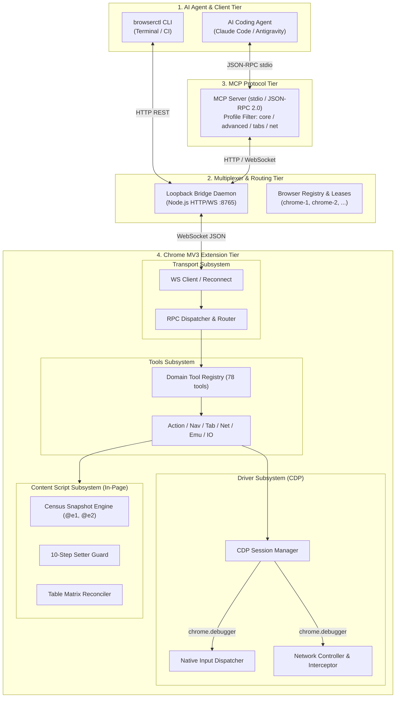
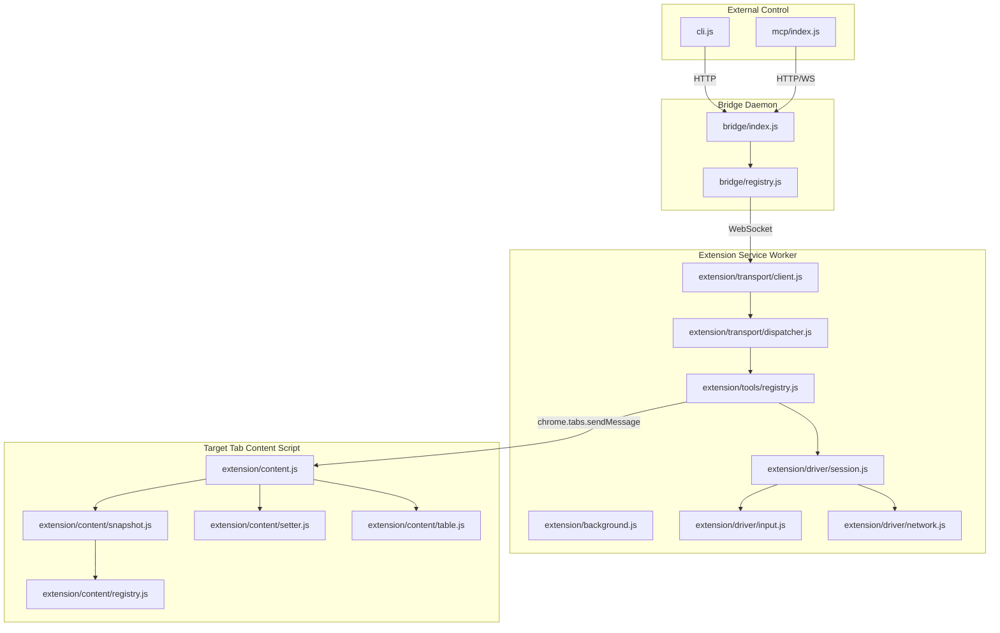

# Specification 00: Architecture Overview & System Topology

## 1. System Purpose & Boundaries

`browserctl` is a production-grade, multi-browser, multi-tab automation platform designed specifically for autonomous AI coding agents (Claude Code, Antigravity, Cline, Cursor) via the Model Context Protocol (MCP) and terminal CLI.

Unlike consumer browser extensions or interactive copilot sidebars, `browserctl` executes headless and headful tasks with deterministic token efficiency, low latency, and robust failure isolation.



---

## 2. Core Architectural Invariants

1. **Zero-Build Native ESM**: The runtime executes pure modern ECMAScript modules (ESM) natively in Node.js (>= 20) and Chromium MV3. No bundlers (Vite, Webpack, WXT, Rollup) or compilation toolchains are required.
2. **Strict Token Economy & @e Indexing**: Interactive DOM elements are indexed with compact `@e` tokens (`@e1`, `@e2`). Default observations use topological pruning and text census to minimize LLM token consumption. Heavy structural or geometric representations are strictly opt-in.
3. **Strict Agent Reading Budget**: The consolidated prompt and tool schemas for the `core` profile must never exceed **20,200 characters** (current baseline: 19,994 chars). Tools are tiered into `core`, `advanced`, `tabs`, and `network`.
4. **Multi-Browser & Multi-Tab Isolation**: The bridge multiplexes connections across multiple isolated browser instances and profiles (`chrome-1`, `chrome-2`, `chrome-3`). Mutations in one tab or profile must not poison another.
5. **Untrusted Page Content Boundary**: Text and DOM structures extracted from web pages are treated strictly as untrusted data, never executed as instructions.
6. **Backward Compatibility Guarantee**: Existing test suites relying on `tests/unit/source-slice.mjs` must continue to pass during and after modularization via barrel re-exports.
7. **Hierarchical Timing Budget (Timing Envelope)**: Outer RPC and WebSocket watchdogs must strictly exceed inner execution budgets by `TIMEOUT_BUFFER_MS` (5,000ms): $\text{OuterWatchdog} = \text{ActionBudget} + \text{GRACE\_SLACK}$. Transport layers must never preempt or abort inner actions with the same millisecond deadline.
8. **Deterministic Actionability & Stabilization FSM**: DOM stabilization (`wait_settle`) must run an immediate quiet check at $t=0$ and filter infinite running animations. Element resolution must filter disconnected/hidden elements and rank candidates by viewport presence before triggering ambiguity guards.

---

## 3. Modular Target Directory Layout

To eliminate monolithic files (`background.js` ~76KB, `content.js` ~178KB, `cdp.js` ~62KB, `mcp/index.js` ~133KB), the codebase is organized into domain-specific modules adhering to strict separation of concerns:

```
browserctl/
├── bridge/                     # Multiplexer daemon & browser profile registry
│   ├── index.js                # Daemon entrypoint & HTTP/WS server
│   ├── registry.js             # Browser profile state & connection map
│   ├── routing.js              # Message router & target resolution
│   └── leases.js               # Tab lease & lock manager
├── mcp/                        # Model Context Protocol stdio server
│   ├── index.js                # Server entrypoint & profile filter
│   ├── protocol.js             # JSON-RPC 2.0 framing & validation
│   ├── profiles.js             # Profile budget gating (core, advanced, tabs, network)
│   └── target.js               # Target selector resolution
├── extension/                  # Chrome MV3 Extension root
│   ├── manifest.json           # MV3 extension manifest
│   ├── background.js           # Service worker entrypoint (barrel & lifecycle)
│   ├── content.js              # Content script entrypoint (barrel & message bridge)
│   ├── cdp.js                  # CDP helper barrel (backward-compatibility shim)
│   ├── core/                   # Extension lifecycle & persistence
│   │   ├── lifecycle.js        # Install, update, keepalive handlers
│   │   ├── storage.js          # chrome.storage.local abstractions
│   │   └── config.js           # Default settings & bridge endpoints
│   ├── transport/              # Extension communication tier
│   │   ├── client.js           # WebSocket connection to bridge with backoff
│   │   ├── dispatcher.js       # In-flight RPC dispatch & abort controller
│   │   └── errors.js           # Standardized RpcError hierarchy
│   ├── driver/                 # CDP & low-level browser driver
│   │   ├── session.js          # chrome.debugger session attachment & lifecycle
│   │   ├── input.js            # Hardware mouse, keyboard, touch, wheel, drag
│   │   ├── emulate.js          # Device viewport, UA, dark mode, geolocation
│   │   ├── network.js          # Network tracking, JSON pointer, request replay
│   │   └── frame.js            # Frame tree cache & cross-frame execution
│   ├── tools/                  # 78 domain-specific automation tools
│   │   ├── registry.js         # Tool definitions, schemas & dispatcher
│   │   ├── action.js           # click, fill, type, press, hover, drag, wheel
│   │   ├── navigate.js         # navigate, reload, history, wait
│   │   ├── tabs.js             # tab list, switch, create, close, group
│   │   ├── inspect.js          # snapshot, find, read_page, evaluate
│   │   ├── network_tools.js    # replay, get_body, mock rules
│   │   ├── emulate_tools.js    # viewport, mobile, geolocation, dark mode
│   │   └── storage_tools.js    # cookie, local/session storage, cache
│   └── content/                # In-page DOM engine & content scripts
│       ├── registry.js         # In-memory node registry (@e indexer)
│       ├── snapshot.js         # DOM snapshot engine & representations (census & tree)
│       ├── table.js            # 2D table matrix reconciler & CSV formula guard
│       ├── setter.js           # 10-step atomic input setter guard
│       ├── frame_bridge.js     # Window postMessage & subframe communicator
│       └── observer.js         # MutationObserver & DOM change debouncer
└── tests/                      # Verification test suites
    ├── unit/                   # Fast VM & module tests (489+ tests)
    ├── e2e/                    # End-to-end tests against real Chromium
    └── benchmark/              # Token efficiency & latency benchmarks
```

---

## 4. Subsystem Dependency & Data Flow



---

## 5. Architectural Migration & Source-Slice Compatibility

To ensure existing test suites (`tests/unit/source-slice.mjs`) remain functional without rewriting 489 tests simultaneously:
1. **Top-Level Barrels**: `extension/background.js`, `extension/content.js`, and `extension/cdp.js` remain at their root paths.
2. **Deterministic Declarations**: Functions imported from new modular files are re-exported using standard named exports, or original top-level declarations are preserved as delegation shims:
   ```javascript
   // extension/content.js
   import { extract_table as _extract_table } from './content/table.js';
   export async function extract_table(options) {
     return _extract_table(options);
   }
   ```
3. **Continuous Verification**: Any change to file organization must immediately pass:
   - `npm test` (all unit suites)
   - `npm run preflight` (all release gates)
   - `tests/e2e/run.mjs` (live browser verification)
