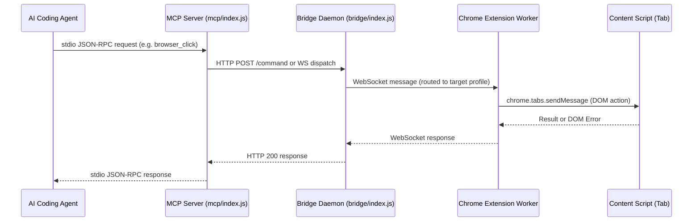

# Specification 01: Protocol Framing, Transports & Error Taxonomy

## 1. Protocol Architecture & Framing

`browserctl` operates on the JSON-RPC 2.0 specification across all communication tiers. The protocol guarantees deterministic serialization, explicit error taxonomies, and bi-directional message dispatch.

### 1.1 Wire Format

#### Request Envelope
```json
{
  "jsonrpc": "2.0",
  "id": "req-98231-1698140400",
  "method": "browser_click",
  "params": {
    "target": "@e14",
    "timeout": 5000
  }
}
```

#### Success Response Envelope
```json
{
  "jsonrpc": "2.0",
  "id": "req-98231-1698140400",
  "result": {
    "status": "ok",
    "clicked": "@e14",
    "coordinates": { "x": 412, "y": 88 }
  }
}
```

#### Error Response Envelope
```json
{
  "jsonrpc": "2.0",
  "id": "req-98231-1698140400",
  "error": {
    "code": -32002,
    "message": "Element not found or no longer present in DOM",
    "data": {
      "reason": "ELEMENT_NOT_FOUND",
      "target": "@e14",
      "retriable": false,
      "details": "Element was removed from document after snapshot e14 was captured."
    }
  }
}
```

#### Notification / Event Envelope (Unsolicited)
```json
{
  "jsonrpc": "2.0",
  "method": "browser_event_download_progress",
  "params": {
    "guid": "b781-42ab",
    "state": "in_progress",
    "bytesReceived": 1048576,
    "totalBytes": 4194304
  }
}
```

---

## 2. Multi-Tier Transport Topology



### 2.1 Transport Channels
1. **Stdio Transport**: Used between the AI Agent and `mcp/index.js`.
   - Newline-delimited JSON (`\n`) for fast streaming.
   - Strictly isolated from standard application logging (`console.error` routed to `stderr`, never `stdout`).
2. **Loopback WebSocket / HTTP**: Used between MCP / CLI and Bridge Daemon (`127.0.0.1:8765`).
   - Reconnect with exponential backoff (`100ms`, `250ms`, `500ms`, max `2000ms`).
   - Tab lease locking to prevent cross-agent collisions.
3. **WebExtensions IPC**: Used between Extension Service Worker and Tab Content Scripts.
   - Structured messaging with timeout enforcement (default `10,000ms`).
   - Automatic fallback to CDP execution if content script context is invalidated during page navigation.

---

## 3. Standardized Error Taxonomy (`RpcError`)

All subsystems must throw or return standardized `RpcError` instances. Ad-hoc string errors or raw unhandled exceptions are strictly forbidden.

### 3.1 Standard JSON-RPC Codes (-32700 to -32603)
| Code | Error Constant | Meaning |
| :--- | :--- | :--- |
| `-32700` | `PARSE_ERROR` | Invalid JSON received by the server. |
| `-32600` | `INVALID_REQUEST` | The JSON sent is not a valid JSON-RPC 2.0 Request object. |
| `-32601` | `METHOD_NOT_FOUND` | The requested tool or method does not exist. |
| `-32602` | `INVALID_PARAMS` | Method parameters failed JSON schema validation. |
| `-32603` | `INTERNAL_ERROR` | Unhandled internal exception within the runtime. |

### 3.2 Application Error Codes (-32000 to -32099)
| Code | Error Constant | Reason Enum | Retriable | Description |
| :--- | :--- | :--- | :--- | :--- |
| `-32001` | `TARGET_NOT_FOUND` | `TARGET_NOT_FOUND` | No | Target tab, window, or browser profile ID does not exist. |
| `-32002` | `ELEMENT_NOT_FOUND` | `ELEMENT_NOT_FOUND` | Yes | Element `@e` token does not exist in registry or has detached. |
| `-32003` | `ELEMENT_NOT_INTERACTABLE`| `ELEMENT_HIDDEN` / `OCCLUDED` | Yes | Element is covered by modal, has 0x0 geometry, or disabled. |
| `-32004` | `NAVIGATION_TIMEOUT` | `NAVIGATION_TIMEOUT` | Yes | Page navigation did not settle within specified timeout. |
| `-32005` | `CDP_ATTACH_FAILED` | `CDP_ATTACH_FAILED` | Yes | `chrome.debugger` could not attach (another debugger active). |
| `-32006` | `EXECUTION_ABORTED` | `ABORTED_BY_SIGNAL` | No | Operation cancelled by user interrupt or in-flight timeout. |
| `-32007` | `DOWNLOAD_FAILED` | `DOWNLOAD_INTERRUPTED` | Yes | Download failed, cancelled, or file write failed on disk. |
| `-32008` | `POLICY_RESTRICTION` | `RESTRICTED_URL` | No | Security boundary violated (e.g. `chrome://` or webstore). |
| `-32009` | `BUDGET_EXCEEDED` | `BUDGET_EXCEEDED` | No | Agent reading prompt budget (20,200 chars) exceeded. |
| `-32010` | `NETWORK_REPLAY_FAILED` | `REPLAY_ERROR` | Yes | Network replay fetch failed or returned client/server error. |

---

## 4. Error Class Definition (`extension/transport/errors.js`)

The `RpcError` class implements the JSON-RPC error contract and guarantees safe object cloning, serialization, and property assignment (`Object.assign` compatibility):

```javascript
export class RpcError extends Error {
  /**
   * @param {number} code
   * @param {string} message
   * @param {object} [data]
   * @param {string} [data.reason]
   * @param {boolean} [data.retriable=false]
   * @param {*} [data.details]
   */
  constructor(code, message, data = {}) {
    super(message);
    this.name = "RpcError";
    this.code = code;
    this.data = {
      reason: data.reason || "UNKNOWN_ERROR",
      retriable: Boolean(data.retriable),
      details: data.details !== undefined ? data.details : null
    };
  }

  get reason() {
    return this.data ? this.data.reason : undefined;
  }

  set reason(val) {
    if (!this.data) this.data = {};
    this.data.reason = val;
  }

  get retriable() {
    return this.data ? this.data.retriable : false;
  }

  set retriable(val) {
    if (!this.data) this.data = {};
    this.data.retriable = Boolean(val);
  }

  get details() {
    return this.data ? this.data.details : null;
  }

  set details(val) {
    if (!this.data) this.data = {};
    this.data.details = val;
  }

  toJSON() {
    return {
      code: this.code,
      message: this.message,
      data: this.data
    };
  }

  static fromError(err) {
    if (err instanceof RpcError) return err;
    return new RpcError(-32603, err.message || "Internal server error", {
      reason: "INTERNAL_ERROR",
      retriable: false,
      details: err.stack
    });
  }
}
```

---

## 5. Hierarchical Timing Budget & Deadline Envelope Specification

### 5.1 The Anti-Pattern: Unbuffered Watchdog Collision
When outer transport wrappers (Bridge, Extension WebSocket Dispatcher) use the exact same `timeoutMs` value as the inner action's execution budget, a race condition occurs at millisecond $T$. The transport layer violently aborts the Promise with a generic `NAVIGATION_TIMEOUT` or socket drop, preventing the action from returning its structured timeout report or helpful diagnostics.

### 5.2 The Hierarchical Deadline Invariant
All multi-tier RPC boundaries must strictly enforce the **Hierarchical Timing Envelope**:
$$\text{OuterWatchdog} = \text{InnerActionBudget} + \text{GRACE\_SLACK}$$
where standard $\text{GRACE\_SLACK} = 5,000\,\text{ms}$.

```
[Agent / MCP Client]       Action Execution Budget: T (e.g. 10,000ms)
       │
       ▼ (Slack: +5,000ms)
[Bridge Daemon]            Bridge Command Timeout: T + 5,000ms (15,000ms)
       │
       ▼ (Slack: +5,000ms)
[Extension Dispatcher]     Transport Watchdog (executeWithAbort): T + 5,000ms (15,000ms)
       │
       ▼
[Content Script / CDP]     Action Execution Budget: T (10,000ms)
                           -> At 10,000ms, inner action resolves gracefully with
                              structured status: { settled: false, waitedMs: 10000, ... }
                              WITHOUT being killed prematurely by the outer watchdog!
```

### 5.3 Budgeted Actions Registry
The following actions accept an explicit caller execution budget (`timeoutMs`) and must be granted `TIMEOUT_BUFFER_MS` at both Bridge and Extension transport boundaries:
- `wait_for`
- `wait_settle`
- `wait_network_idle`
- `download`
- `request_help`
- `exec_system_cmd`

---

## 6. Request Cancellation & Abort Controller Contract

Every in-flight action must accept an `AbortSignal` and register cleanup hooks to prevent zombie browser operations. The transport watchdog must only trigger when the inner action has exceeded its budget plus the grace slack:

```javascript
// Transport dispatcher pattern with Hierarchical Timing Envelope
const inFlightRequests = new Map();
const DEFAULT_ACTION_BUDGET_MS = 60_000;
const TRANSPORT_GRACE_SLACK_MS = 5_000;

export function computeTransportTimeout(params) {
  const actionTimeout = Number(params && (params.timeoutMs || params.timeout));
  if (Number.isFinite(actionTimeout) && actionTimeout > 0) {
    return actionTimeout + TRANSPORT_GRACE_SLACK_MS;
  }
  return DEFAULT_ACTION_BUDGET_MS;
}

export async function executeWithAbort(requestId, timeoutMs, handler) {
  const controller = new AbortController();
  let timer = null;

  if (typeof timeoutMs === "number" && timeoutMs > 0 && timeoutMs < Infinity) {
    timer = setTimeout(() => {
      controller.abort(new RpcError(-32004, "Operation timed out", { reason: "TIMEOUT", retriable: true }));
    }, timeoutMs);
  }

  if (requestId != null) inFlightRequests.set(requestId, controller);

  try {
    return await handler(controller.signal);
  } finally {
    if (timer) clearTimeout(timer);
    if (requestId != null) inFlightRequests.delete(requestId);
  }
}
```
