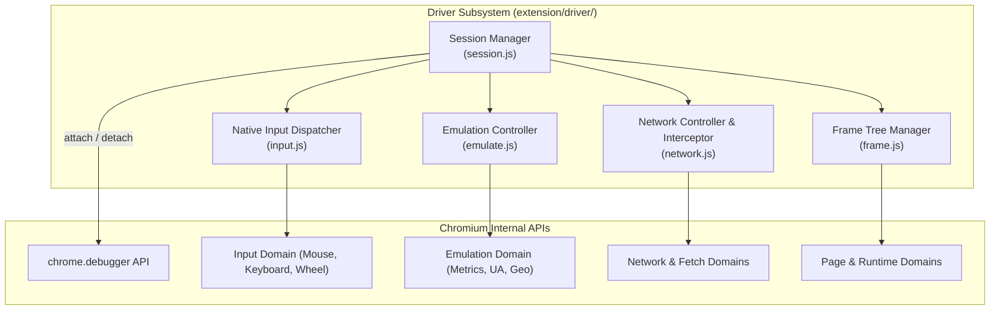

# Specification 02: CDP Driver Architecture & Low-Level Browser Automation

## 1. CDP Driver Subsystem Role

The `driver/` subsystem manages low-level Chromium DevTools Protocol (CDP) commands using `chrome.debugger`. It provides hardware-level input simulation, network observation and mocking, viewport and device emulation, and multi-frame runtime execution.



---

## 2. CDP Session Lifecycle (`extension/driver/session.js`)

### 2.1 Invariants & Concurrency Rules
1. **Target Attachment Version**: `chrome.debugger.attach({ tabId }, "1.3")`.
2. **Single-Attachment Lock**: CDP allows only one debugger client per target tab. If a debugger is already attached by another process, fail gracefully with code `-32005` (`CDP_ATTACH_FAILED`).
3. **Auto-Detach on Navigation/Closure**: Register `chrome.tabs.onRemoved` and `chrome.debugger.onDetach` listeners to clear session state immediately without leaking handles.
4. **Structured Command Dispatch**: Every command must be wrapped in a deterministic promise with timeout handling:

```javascript
export async function sendCdpCommand(tabId, method, params = {}, timeoutMs = 10000) {
  return new Promise((resolve, reject) => {
    const timer = setTimeout(() => {
      reject(new RpcError(-32004, `CDP command ${method} timed out`, { reason: "CDP_TIMEOUT" }));
    }, timeoutMs);

    chrome.debugger.sendCommand({ tabId }, method, params, (result) => {
      clearTimeout(timer);
      const lastErr = chrome.runtime.lastError;
      if (lastErr) {
        return reject(new RpcError(-32005, lastErr.message, { reason: "CDP_COMMAND_ERROR" }));
      }
      resolve(result || {});
    });
  });
}
```

---

## 3. Native Input Dispatcher (`extension/driver/input.js`)

### 3.1 Mouse Wheel Simulation (`browser_wheel`)
Dispatches hardware mouse wheel events via CDP `Input.dispatchMouseEvent`:
```javascript
export async function dispatchMouseWheel(tabId, { x, y, deltaX = 0, deltaY = 0, modifiers = 0 }) {
  await sendCdpCommand(tabId, "Input.dispatchMouseEvent", {
    type: "mouseWheel",
    x: Math.round(x),
    y: Math.round(y),
    deltaX: Math.round(deltaX),
    deltaY: Math.round(deltaY),
    modifiers: Number(modifiers) || 0
  });
}
```

### 3.2 Coordinate & Element Drag (`browser_drag`)
Performs multi-step hardware mouse interpolation from source `(fromX, fromY)` to destination `(toX, toY)`:
1. `Input.dispatchMouseEvent(type: "mouseMoved", x: fromX, y: fromY)`
2. `Input.dispatchMouseEvent(type: "mousePressed", button: "left", clickCount: 1)`
3. Intermediate interpolation: 5 to 10 intermediate `mouseMoved` steps with small delays (15ms) to trigger Chromium drag events.
4. `Input.dispatchMouseEvent(type: "mouseMoved", x: toX, y: toY)`
5. `Input.dispatchMouseEvent(type: "mouseReleased", button: "left")`

### 3.3 Keyboard Dispatcher
- Dispatches `rawKeyDown`, `keyDown`, `keyUp`, and `char` events with correct virtual key codes, scan codes, and modifier bitmasks (`Alt: 1, Ctrl: 2, Meta: 4, Shift: 8`).

### 3.4 OS Window Focus Invariant & DOM Fallback Contract
Chromium drops CDP synthetic mouse and keyboard events if the target tab's browser window is not focused at the operating system level (`win.focused === false`).
1. **Foreground Guard (`requireForegroundForInput`)**:
   - Actions requiring hardware input (`coordinate_click`, `coordinate_drag`, `wheel`, `press_key` with physical modifiers) verify that `tab.active && win.focused`.
   - If not in foreground, the driver throws a descriptive refusal with actionable recovery hints:
     `"wheel needs the target tab in the foreground (its window is not focused). Either foreground it first (switch_tab {id, focus:true}), or use a DOM-level equivalent that works in the background."`
2. **DOM-Level Fallback Contract**:
   - For background automation or automated CI runners where OS focus cannot be stolen, callers should route interactions via DOM-level tools:
     - `click` / `click_selector` by ref or CSS selector (dispatches DOM PointerEvent).
     - `type` / `fill_form` (uses the 10-step reactive setter guard).
     - `scroll` (uses `window.scrollBy` / `element.scrollIntoView`).
     - `press_key` with `{ allowSynthetic: true }` (dispatches synthetic in-page KeyboardEvent).

---

## 4. Emulation & Device Controller (`extension/driver/emulate.js`)

Supported Presets and Manual Parameters:
- **Preset Configurations**:
  - `iphone-14`: Viewport `390x844`, DPR `3`, Mobile `true`, Touch `true`, iPhone Safari UA.
  - `pixel-7`: Viewport `412x915`, DPR `2.625`, Mobile `true`, Touch `true`, Android Chrome UA.
  - `ipad`: Viewport `820x1180`, DPR `2`, Mobile `true`, Touch `true`, iPad Safari UA.
  - `desktop`: Viewport `1280x800`, DPR `1`, Mobile `false`, Touch `false`, Standard Desktop UA.
- **Emulated Color Scheme**:
  - `prefers-color-scheme: dark | light | none` via `Emulation.setEmulatedMedia`.
- **Geolocation Override**:
  - `Emulation.setGeolocationOverride` with latitude, longitude, and accuracy.
- **Offline & Network Throttling**:
  - `Network.emulateNetworkConditions` to simulate offline mode or packet throttling.
- **Reset Invariant (`clear` / `off`)**:
  - `Emulation.clearDeviceMetricsOverride()`
  - `Emulation.clearGeolocationOverride()`
  - `Network.emulateNetworkConditions({ offline: false, latency: 0, downloadThroughput: -1, uploadThroughput: -1 })`

---

## 5. Network Controller & Interception (`extension/driver/network.js`)

### 5.1 RFC 6901 JSON Pointer Traversal
Provides zero-dependency pointer navigation on complex JSON API payloads:
```javascript
export function resolveJsonPointer(obj, pointer) {
  if (!pointer || pointer === "" || pointer === "/") return obj;
  const segments = pointer.replace(/^\//, "").split("/").map((seg) =>
    seg.replace(/~1/g, "/").replace(/~0/g, "~")
  );
  let cur = obj;
  for (const seg of segments) {
    if (cur == null || typeof cur !== "object") return undefined;
    cur = cur[seg];
  }
  return cur;
}
```

### 5.2 Network Mocking via `Fetch.enable`
- Intercepts requests using `Fetch.requestPaused`.
- Matches URL pattern, HTTP method, and resource type.
- Actions:
  - `Fetch.fulfillRequest` (mock response code, headers, base64/text body).
  - `Fetch.failRequest` (simulate connection failure `Failed`, `Aborted`, `AccessDenied`).
  - `Fetch.continueRequest` (passthrough with optional header overrides).

### 5.3 In-Page Context Request (`make_request`) & Replay (`network_replay`)
- **Execution Target**: Executes directly in the tab's main execution context using `window.fetch` via content script messaging or `Runtime.evaluate`.
- **Zero CDP Requirement**: Does not require attaching `chrome.debugger` (`cdp_attach`), eliminating automated test warnings and browser infobars.
- **Dual Mode: Inherit vs Custom**:
  - **Inherit Mode (`credentials: "include"`, default)**: Automatically inherits session state, `HttpOnly` and `SameSite` cookies, `Origin`, `Referer`, CORS policies, and client TLS fingerprints.
  - **Custom Mode (`credentials: "omit" | "same-origin"`)**: Allows isolated, clean HTTP requests with explicit header control (`Authorization`, `X-Custom-*`) without polluting or relying on tab session cookies.
- **Payload & Query Adaptation**:
  - Auto-encodes `query` dictionary into URL search params.
  - Automatically stringifies JSON object payloads and asserts `Content-Type: application/json; charset=utf-8`.
  - Supports string, form-data, and raw payloads.
- **Robust Error Handling**:
  - Does not reject on HTTP 4xx/5xx; returns complete `{ ok: false, status, statusText, headers, data, text, curl }` for diagnostic evaluation.
  - Rejects with structured errors on network disconnection or AbortController timeout.
- **RFC 6901 Pointer Plucking**: Supports `pointer` to extract nested target fields from large JSON responses without exceeding model context limits.

### 5.4 Minimal cURL Generator
Every `make_request` execution produces a sanitized, ready-to-copy `curl` invocation in its result:
- Strips ephemeral, noisy browser headers (`sec-ch-ua`, `sec-fetch-*`, `:authority`, `:path`).
- Preserves core headers: `Authorization`, `Content-Type`, `Accept`, custom `X-*`, and session cookies when explicitly requested.
- Shell-escapes URL, headers, and payload for cross-platform POSIX and PowerShell compatibility.

### 5.5 Unified Network Monitor (`monitor_requests`) & Wait Primitive (`wait_for_request`)
- **Actions**:
  - `list`: Enumerates captured network traffic with comprehensive filtering:
    - `url_pattern`: Wildcard (`*api/v1/*`) or regex substring matching.
    - `method`: HTTP method filter (`GET`, `POST`, `PUT`, `DELETE`).
    - `status`: Specific status code or range (e.g. `200`, `4xx`).
    - `resource_type`: `fetch`, `xhr`, `document`, `websocket`, or `all`.
    - `include_body`: Inline response body retrieval without secondary round-trips.
    - `limit` & `since_id`: Pagination and delta retrieval.
  - `get`: Full fidelity inspect for a single `requestId` including request headers, POST body, response headers, and body with optional JSON pointer.
  - `clear`: Purges captured network event buffer.
  - `wait` (`wait_for_request`): Suspends execution until a network request/response matching `url_pattern` and `method` settles or timeout expires.
- **Backward Compatibility Aliases**: `get_network_requests`, `get_network_request`, `get_response_body`, and `network_replay` remain operational as thin compatibility facades delegating to the unified engine.
