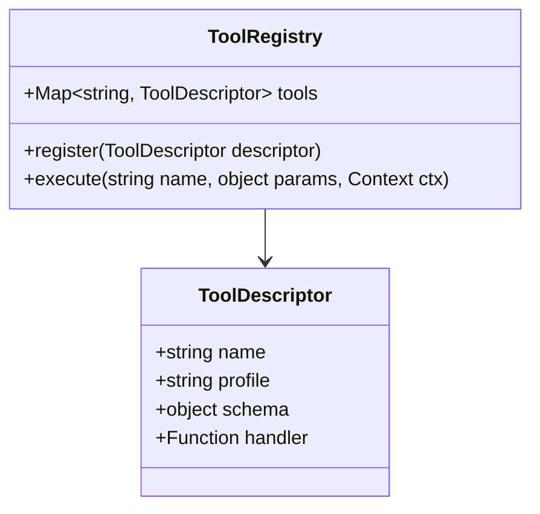
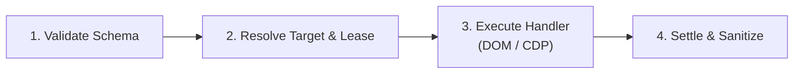

# Specification 03: Tool Domain Registry & Handler Contracts

## 1. Tool Domain Organization (78 Tools Total)

To prevent a single monolithic tool switch-case statement, tools are partitioned into domain-specific modules under `extension/tools/`. Each module exports an array or map of tool descriptors.



### 1.1 Domain Distribution Matrix

| Domain Module | Primary Tools Included | Profile |
| :--- | :--- | :--- |
| `action.js` | `browser_click`, `browser_fill_form`, `browser_type`, `browser_hover`, `browser_press_key`, `browser_select_option`, `browser_wheel`, `browser_drag` | `core` & `advanced` |
| `navigate.js` | `browser_navigate`, `browser_wait_for`, `browser_reload`, `browser_history_back`, `browser_history_forward` | `core` & `advanced` |
| `inspect.js` | `browser_snapshot`, `browser_find`, `browser_read_page`, `browser_get_content`, `browser_get_property`, `browser_extract`, `browser_evaluate`, `browser_take_screenshot` | `core` & `advanced` |
| `tabs.js` | `browser_tabs` (list, switch, create, close, group, duplicate, pin) | `tabs` & `advanced` |
| `network_tools.js` | `browser_make_request`, `browser_monitor_requests`, `wait_for_request`, `network_rule_mock`, `network_rule_block`, `network_rule_clear` | `network` & `advanced`|
| `emulate_tools.js` | `browser_emulate` (device presets, viewport, userAgent, dark mode, geolocation, offline) | `advanced` |
| `download_tools.js`| `browser_download` (trigger, track progress, save on disk) | `advanced` |
| `storage_tools.js` | `cookies_get`, `cookies_set`, `cookies_clear`, `local_storage_get`, `local_storage_set` | `advanced` |

---

## 2. Standard Handler Contract & Interface

Every tool handler must conform to the following signature:

```javascript
/**
 * Standard Tool Handler Interface
 * @param {object} params - Validated tool input parameters
 * @param {ExecutionContext} ctx - Execution context & subsystem bridges
 * @returns {Promise<object>} Standard JSON result object
 * @throws {RpcError} Standardized RPC error
 */
export async function execute(params, ctx) {
  // 1. Verify target tab availability
  const tabId = ctx.resolveTabId(params.target);

  // 2. Perform DOM or CDP automation
  // 3. Return structured payload
  return { status: "ok" };
}
```

### 2.1 Context Definition (`ExecutionContext`)
The `ctx` object provides isolated, dependency-injected services:
```javascript
export class ExecutionContext {
  constructor({ tabId, browserProfile, signal, driver, contentBridge }) {
    this.tabId = tabId;
    this.browserProfile = browserProfile;
    this.signal = signal;               // AbortSignal
    this.driver = driver;               // CDP Driver instance
    this.contentBridge = contentBridge; // Tab IPC bridge
  }
}
```

---

## 3. Tool Execution Pipeline & Middleware Invariants

All tool invocations pass through a deterministic four-stage lifecycle:



1. **Schema Validation**:
   - Verify required properties (`target`, `selector`, `url`, `text`).
   - Reject unexpected types with `INVALID_PARAMS` (`-32602`).
2. **Target & Lease Resolution**:
   - If `@e` token supplied (e.g. `@e5`), verify it exists in the active tab's registry.
   - Enforce active tab lease locks if bridge is operating in multi-agent mode.
3. **Execution with Abort Propagation**:
   - Check `ctx.signal.aborted` before starting.
   - Abort in-flight network or CDP calls immediately when signal fires.
4. **Settle & Sanitize Result**:
   - Formula Injection Protection: If extracting tabular data, enforce `csv_safe` quoting on strings starting with `=`, `+`, `-`, `@`, `\t`, `\r`.
   - Strip internal DOM properties and cyclic references before JSON serialization.

---

## 4. Agent Reading Budget Invariant

- **Hard Limit**: Consolidated text for `core` profile descriptions and schemas must remain strictly `<= 20,200 characters`.
- **Current Core Usage**: `19,994` characters (budget headroom: 206 chars).
- **Rule**: No new tool may be assigned to the `core` profile without removing or condensing existing tool definitions to maintain the `< 20,200` budget. Specialized tools (emulate, drag, wheel, network replay, download) must default to `advanced` or their respective domain profiles. Optional parameters (such as `format: "vom"` for layout inspection in `browser_snapshot`) must remain concise to stay within the profile budget headroom.
