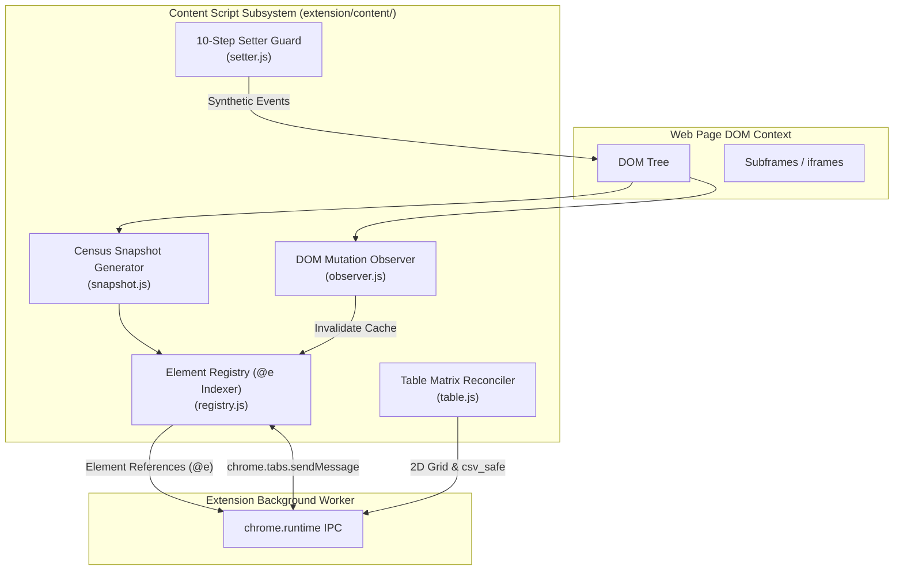
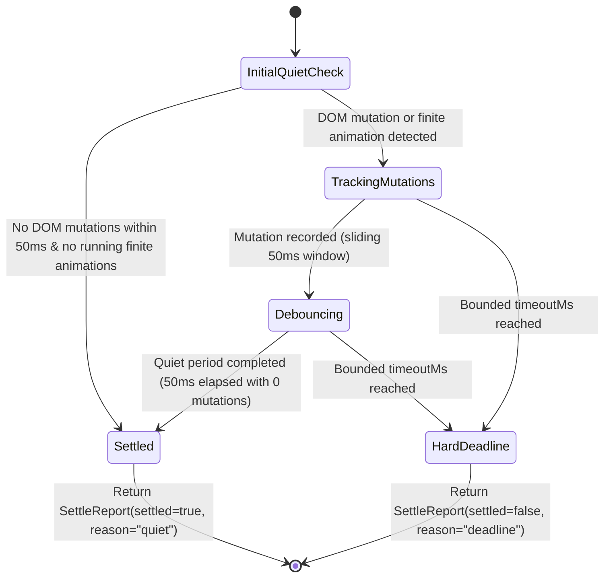

# Specification 04: Content Script DOM Engine, Census Snapshot & Element Registry

## 1. Content Script Architecture

The content script subsystem operates directly within web page contexts. It executes DOM observation, element accessibility indexing, atomic input dispatch, and 2D table matrix extraction.



---

## 2. Census DOM Snapshot Engine (`extension/content/snapshot.js`)

### 2.1 The `@e` Element Indexing Invariant
- Interactive nodes (links, buttons, inputs, selects, textareas, elements with `role` or click listeners) are indexed sequentially as `@e1`, `@e2`, `@e3`, etc.
- References using the deprecated `@ref` format are strictly forbidden and will fail schema validation.

### 2.2 Pruning & Token Trimming Rules
To keep agent prompt context small and token-efficient:
1. **Visibility Pruning**: Skip elements with:
   - `display: none`
   - `visibility: hidden`
   - `opacity: 0` (unless interactive child within)
   - Zero bounding client rect (`width === 0 && height === 0`)
   - `aria-hidden="true"`
2. **Text Compaction**: Collapse redundant whitespace, strip script/style tags, and truncate text nodes longer than 150 characters with `...`.
3. **Role & Attribute Normalization**: Emit accessible roles (`button`, `link`, `textbox`, `checkbox`, `combobox`) and essential states (`checked`, `disabled`, `expanded`, `selected`).

### 2.3 Output Representation Formats
The snapshot engine supports three output modes:
1. **Compact Census Text (Default)**: Single line per interactive element with `@e` token and reading label. Optimized for minimum token consumption.
2. **Structured Elements (`elements: true`)**: Flat JSON list of interactive element objects.
3. **Virtual Object Model Tree (`format: "vom"`, Opt-in)**: Hierarchical node tree with viewport-relative bounding boxes (`rect: {x, y, w, h}`), parentage (`parentId`, `depth`), and layer classification (`layer: "page" | "modal" | "mask"`). Used when layout or occlusion diagnosis is requested. Retains unified `@e` identifiers; bounded by `maxDepth` (default: 8) and `redactValues: true`.

---

## 3. 10-Step Atomic Setter Guard (`extension/content/setter.js`)

Modern reactive frameworks (React, Vue, Angular, Svelte) intercept standard `.value = val` assignments via custom prototype descriptors. To reliably trigger state synchronization without page corruption:

```javascript
export function setElementValue(element, value) {
  // 1. Focus element
  element.focus();

  // 2. Dispatch pointerdown / mousedown
  element.dispatchEvent(new PointerEvent("pointerdown", { bubbles: true }));
  element.dispatchEvent(new MouseEvent("mousedown", { bubbles: true }));

  // 3. Locate prototype setter to bypass framework proxies
  const prototype = Object.getPrototypeOf(element);
  const descriptor = Object.getOwnPropertyDescriptor(prototype, "value");
  if (descriptor && descriptor.set) {
    descriptor.set.call(element, value);
  } else {
    element.value = value;
  }

  // 4. Dispatch beforeinput
  element.dispatchEvent(new InputEvent("beforeinput", { bubbles: true, inputType: "insertText", data: value }));

  // 5. Dispatch input event (Crucial for React 16+)
  element.dispatchEvent(new Event("input", { bubbles: true, composed: true }));

  // 6. Dispatch change event
  element.dispatchEvent(new Event("change", { bubbles: true }));

  // 7. Dispatch pointerup / mouseup
  element.dispatchEvent(new PointerEvent("pointerup", { bubbles: true }));
  element.dispatchEvent(new MouseEvent("mouseup", { bubbles: true }));

  // 8. Dispatch blur / settle
  element.dispatchEvent(new Event("blur", { bubbles: true }));
}
```

---

## 4. Structured Extraction Engine: Table, Grid, List & Discovery (`extension/content/table.js`)

The structured extraction engine provides passive, declarative data extraction across HTML tables, ARIA grids, virtualized lists, and nested components without mutating DOM state or triggering navigation.

```
+---------------------------------------------------------------------------------------+
|                                    Document DOM                                       |
|  <table> / [role="table|grid|treegrid"]  |  <ul>, <ol> / [role="list"]  |  Shadow DOM |
+-------------------------------------------+-------------------------------------------+
                                            │
                                            ▼
                    +-----------------------------------------------+
                    |       Collector: collectExtractDom()          |
                    |  - Action modes: discover | table | list      |
                    |  - Nested container boundary isolation        |
                    |  - Text normalization & input value reading   |
                    |  - Omit hidden subtrees & overlays            |
                    |  - Collect ARIA indices & spans               |
                    +-----------------------------------------------+
                                            │
                                            ▼
                    +-----------------------------------------------+
                    |       Normalizer: normalizeExtract()          |
                    |  - Logical 2D matrix resolution               |
                    |  - Multi-tier header hierarchy (header_path)  |
                    |  - Split ARIA row fragment joining            |
                    |  - Cell spans & row provenance tracking       |
                    |  - Coverage & dataset completeness check      |
                    +-----------------------------------------------+
                                            │
                                            ▼
                    +-----------------------------------------------+
                    |       Budget Guard: fitExtractBudget()        |
                    |  - Binary search row pruning within max_bytes |
                    |  - Atomic complete-row guarantee              |
                    +-----------------------------------------------+
                                            │
                                            ▼
                                  ExtractResult JSON
```

### 4.1 Action Modes

1. **`action: "discover"`**:
   - Scans document DOM, open shadow roots, and available frames for semantic table and list containers (`table`, `[role="table"]`, `[role="grid"]`, `[role="treegrid"]`, `ul`, `ol`, `[role="list"]`).
   - Filters out layout tables (`role="presentation"`, `role="none"`).
   - Generates bounded candidate handles (`target_id`), container kinds, preview column headers (up to 8 headers), and labels/captions.
   - Capped at 32 returned targets; marks truncation with `stop_reason: "target_limit"`.

2. **`action: "table"`**:
   - Reconciles native HTML tables and ARIA tables/grids/treegrids into a normalized rectangular dataset.
   - Outputs canonical column keys (`c1`, `c2`, ...), human-readable column names, hierarchical `header_path`, cell values (or `null` for span-covered cells), cell `spans`, `row_sources`, and `coverage`.

3. **`action: "list"`**:
   - Extracts repeating items from containers (via `item_selector` or semantic `li, [role="listitem"]`).
   - Supports declarative field schemas (`fields: [{ key, selector, read: "text"|"href"|"attribute", attribute? }]`).
   - Resolves links absolutely against `element.baseURI`, flags ambiguous multiple matches per row (`extract_field_ambiguous`), and maps scoped fields via `:scope`.

### 4.2 Semantic Containers & Nested Table Boundary Isolation

> [!IMPORTANT]
> **Nested Container Boundary Invariant**:
> Nested tables and lists are independent targets. When collecting rows and cells for an active container, any element whose closest matching semantic container is not the target root must be excluded:
> `element.closest(tableSelector) === rootContainer`
> Cells or rows of an inner table must never leak into the parent table's 2D matrix or text content.

1. **Native HTML Tables**:
   - Root: `<table>`, rows: `<tr>` (or `table.rows`), cells: `<th>` and `<td>`.
   - Headers: `<thead>`, `<th>`, or cells with `scope="col"` or `scope="colgroup"`.
   - Footers: `<tfoot>`.
   - Cell spanning: `rowspan` and `colspan`, including `rowspan="0"` (extending to the end of the current row group `<tbody>`).

2. **ARIA Tables, Grids, and Treegrids**:
   - Roles: `[role="table"]`, `[role="grid"]`, `[role="treegrid"]`.
   - Rows: `[role="row"]`.
   - Cells: `[role="cell"]`, `[role="gridcell"]`, `[role="columnheader"]`, `[role="rowheader"]`.
   - Cell spanning: `aria-rowspan` and `aria-colspan` (defaulting to 1 if omitted or invalid).

### 4.3 Multi-Tier Column Header Hierarchy (`header_path`)

Complex financial, scientific, or reporting tables feature multi-row grouped headers (e.g. `Year > 2024 > Q1`).
1. For each column, all active header cells spanning that column index across header rows are accumulated into an ordered array: `header_path = ["Year", "2024", "Q1"]`.
2. Column display names are formatted by joining the path: `header_path.join(" / ")` (e.g. `"Year / 2024 / Q1"`).
3. If no header text exists, generated names are assigned (`name_source: "generated"`, e.g. `"Column 1"`), and `generated_column_names` is recorded in `warnings`.
4. When cells declare explicit `headers` attributes (e.g. `<td headers="hdr-id1 hdr-id2">`), explicit header IDs take precedence over physical column alignment.

### 4.4 Virtualized Grids & Split ARIA Row Joining

Modern enterprise grids (AG-Grid, Datatables, SlickGrid) implement virtualization and sticky/pinned columns where:
- Rows may be rendered out of DOM order.
- A single logical row is split across multiple container fragments (e.g. pinned left columns in container A, scrollable columns in container B).

**Algorithm**:
1. Check `aria-rowindex` on each `[role="row"]`. If explicit indices are present:
   - Sort rows logically by `source_row = aria-rowindex`.
   - If adjacent fragments share the same `source_row` and agree on row kind (`data` vs `footer`):
     - Verify both fragments declare explicit, non-overlapping `aria-colindex` values.
     - Join fragments into a unified `RawRow`: merge cell lists, combine locators (`locA + " | " + locB"`), and record warning `split_aria_rows_merged`.
     - Reject conflicting/overlapping cells with `extract_structure_invalid`.

### 4.5 Cell Spans & Row Provenance Metadata

1. **Cell Spans (`spans`)**:
   - For any cell with `row_span > 1` or `column_span > 1`, a span record is emitted:
     `{ row: outputRowIndex, column: "c1", row_span: 2, column_span: 1 }`.
   - In the data rows, the anchor cell holds the extracted text. All other coordinates covered by the span are set to `null` (not duplicate copies).
2. **Row Provenance (`row_sources`)**:
   - Every extracted row records its origin:
     - `row`: 0-based index in the returned `rows` array.
     - `source_row`: 1-based logical DOM or ARIA row position.
     - `row_kind`: `"data"` or `"footer"`.
     - `locator`: Diagnostic CSS path (e.g. `table#orders > tbody > tr:nth-of-type(2)` or `#order-123`).

### 4.6 Coverage Determination & Progressive Truncation

1. **Coverage Metadata (`coverage`)**:
   - `rows_returned`: Exact count of complete rows in the result.
   - `truncated`: Boolean indicating whether collection was stopped early by resource limits.
   - `dataset_complete`: `"unknown"` (loaded DOM provides no proof of total size) or `"incomplete"` (gaps detected in `aria-rowindex`, declared `aria-rowcount` exceeds returned count, or budget stopped collection).
   - `declared_rows` / `declared_columns`: Parsed from `aria-rowcount` and `aria-colcount` on the container.
   - `stop_reason`: `"row_limit"`, `"byte_limit"`, `"target_limit"`, or `"time_limit"`.

2. **Defensive Budget Enforcement (`fitExtractBudget`)**:
   - The overall JSON output size is strictly constrained by `max_bytes` (default 1,048,576 bytes; MCP default 262,144 bytes).
   - If serialized output exceeds `max_bytes`, binary search row pruning (`use(mid)`) is executed to return the maximum number of **complete rows** that fit within budget.
   - Metadata and individual rows are never sliced mid-object or mid-string. If the first complete row cannot fit, it throws `extract_limit`.

### 4.7 CSV Formula Injection Guard (CWE-1236)

When exporting extracted data to CSV, any cell string beginning with an executable trigger character (`=`, `+`, `-`, `@`, `\t`, `\r`) must be escaped by prepending an apostrophe (`'`) when `csv_safe: true` (the default):
```javascript
export function csv_safe(val) {
  if (val == null) return "";
  const s = String(val);
  if (/^[=+\-@\t\r]/.test(s)) {
    return "'" + s;
  }
  return s;
}
```

### 4.8 Canonical Extraction Result Schema

```typescript
export interface ExtractResult {
  schema_version: 1;
  kind: "discover" | "table" | "list";
  tab_id: number;
  source: {
    page_url: string;
    frame_url: string;
    frame_id: string;
    title: string;
    captured_at: string;
    selector?: string;
    target_id?: string;
  };
  columns: Array<{
    key: string;               // "c1", "c2", ...
    name: string;              // "Header Name" or "Group / Subgroup"
    header_path: string[];     // ["Group", "Subgroup"]
    name_source: "header" | "generated" | "field";
  }>;
  rows: Array<Record<string, string | null>>; // [{ c1: "val", c2: null }]
  row_sources: Array<{
    row: number;               // 0-based returned row index
    source_row: number;        // 1-based DOM/ARIA source row
    row_kind: "data" | "footer";
    locator: string;           // Diagnostic CSS locator
  }>;
  spans: Array<{
    row: number;
    column: string;            // "c1"
    row_span: number;
    column_span: number;
  }>;
  coverage: {
    scope: "loaded_dom";
    rows_returned: number;
    truncated: boolean;
    dataset_complete: "unknown" | "incomplete";
    stop_reason?: string;
    declared_rows?: number;
    declared_columns?: number;
  };
  warnings: string[];
  targets?: Array<{
    target_id: string;
    kind: "table" | "list";
    name: string;
    columns: string[];
  }>;
}
```

---

## 5. Multi-Frame Context Handling (`extension/content/frame_bridge.js`)

1. **Same-Origin iframes**:
   - Content script inspects `iframe.contentDocument` directly.
   - Assigns namespaced IDs: `@e12(iframe#login)`.
2. **Cross-Origin iframes**:
   - Direct DOM access is blocked by browser security sandbox.
   - The content script emits frame descriptor metadata (`frameId`, `src`, `rect`).
   - The tool dispatcher routes execution through CDP `driver/frame.js` using `Runtime.evaluate` targeted at the subframe's specific execution context ID.

---

## 6. Stabilization Finite State Machine (`wait_settle`)

### 6.1 Architecture & State Transitions
Page settling must never rely on passive mutation listeners or unbuffered `setTimeout` calls. The settling engine implements a strict Finite State Machine (FSM):



### 6.2 The Three Invariants of the Settle FSM
1. **Immediate Initial Debounce Invariant**:
   - When `wait_settle` begins, an active 50ms debounce timer is started immediately.
   - If the page is already quiet (0 mutations occur), the FSM transitions to `Settled` after 50ms instead of waiting for the full `timeoutMs` budget.
2. **Finite vs. Infinite Animation Invariant**:
   - SPA platforms (YouTube, Facebook, GitHub) continuously run infinite CSS keyframes (spinners, skeleton pulses, background ambient animations).
   - The FSM filters out all non-finite animations:
     ```javascript
     function isFiniteRunningAnimation(anim) {
       if (anim.playState !== "running") return false;
       if (anim.playbackRate <= 0) return false;
       const timing = anim.effect ? anim.effect.getTiming() : null;
       if (timing && timing.iterations === Infinity) return false;
       return true;
     }
     ```
   - Only finite user transitions or layout animations block the `settled` state.
3. **No-Throw Structured Contract**:
   - Reaching `timeoutMs` is a valid domain outcome, not an exceptional crash.
   - The FSM always resolves with a structured `SettleReport`:
     ```typescript
     interface SettleReport {
       settled: boolean;
       readyState: DocumentReadyState;
       waitedMs: number;
       mutationCount: number;
       activeAnimations: number;
       reason: "quiet" | "deadline";
     }
     ```

---

## 7. Deterministic Element Resolution Pipeline (`resolveTarget`)

### 7.1 Pipeline Stages
To prevent false-positive `ambiguous target` errors on responsive websites that duplicate DOM nodes for mobile/desktop layouts:

```
[Target Query: ref | css | text | role]
                 │
                 ▼
     Stage 1: DOM Connectivity
     Filter candidates: node.isConnected === true
                 │
                 ▼
     Stage 2: Strict Actionability & Visibility Filter
     Filter out elements with:
     - display === "none"
     - visibility === "hidden"
     - getBoundingClientRect() has width === 0 && height === 0
                 │
                 ▼
     Stage 3: Viewport Intersection Scoring
     Rank candidates:
     - Score 2: Visible & intersects viewport (top < window.innerHeight && bottom > 0)
     - Score 1: Visible but off-screen
                 │
                 ▼
     Stage 4: Cardinality & Disambiguation Guard
     - Count === 0 -> Throw ELEMENT_NOT_FOUND (-32002) with candidates/hints
     - Exactly 1 highest-scoring candidate -> Return target deterministically
     - >1 equally-ranked actionable candidates -> Throw AMBIGUOUS_TARGET with @e tokens
```

### 7.2 Disambiguation Exception Format
If and only if multiple elements pass Stages 1-3 with identical highest scores:
```json
{
  "code": -32003,
  "message": "ambiguous target \"input[name='search']\" matched 2 visible elements: @e57 <input> \"Search Wikipedia\", @e73 <input> \"Search Wikipedia\". Disambiguate with a ref, prefix (css=, text=, placeholder=), or a more specific string."
}
```
