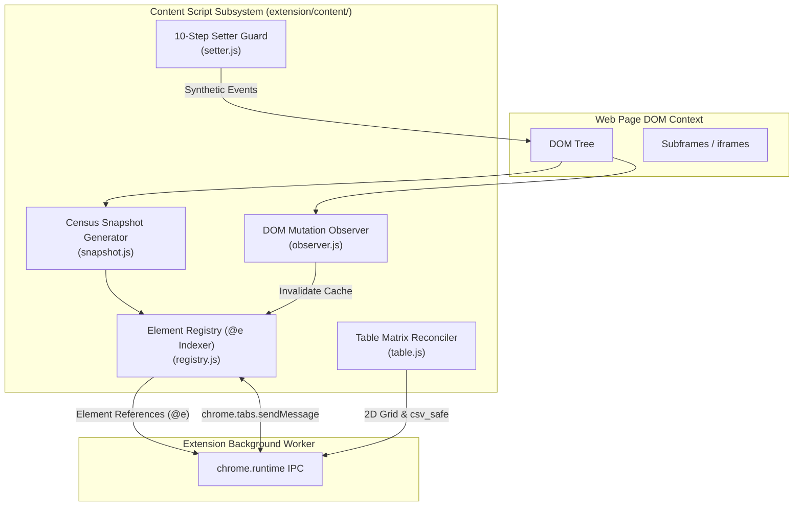
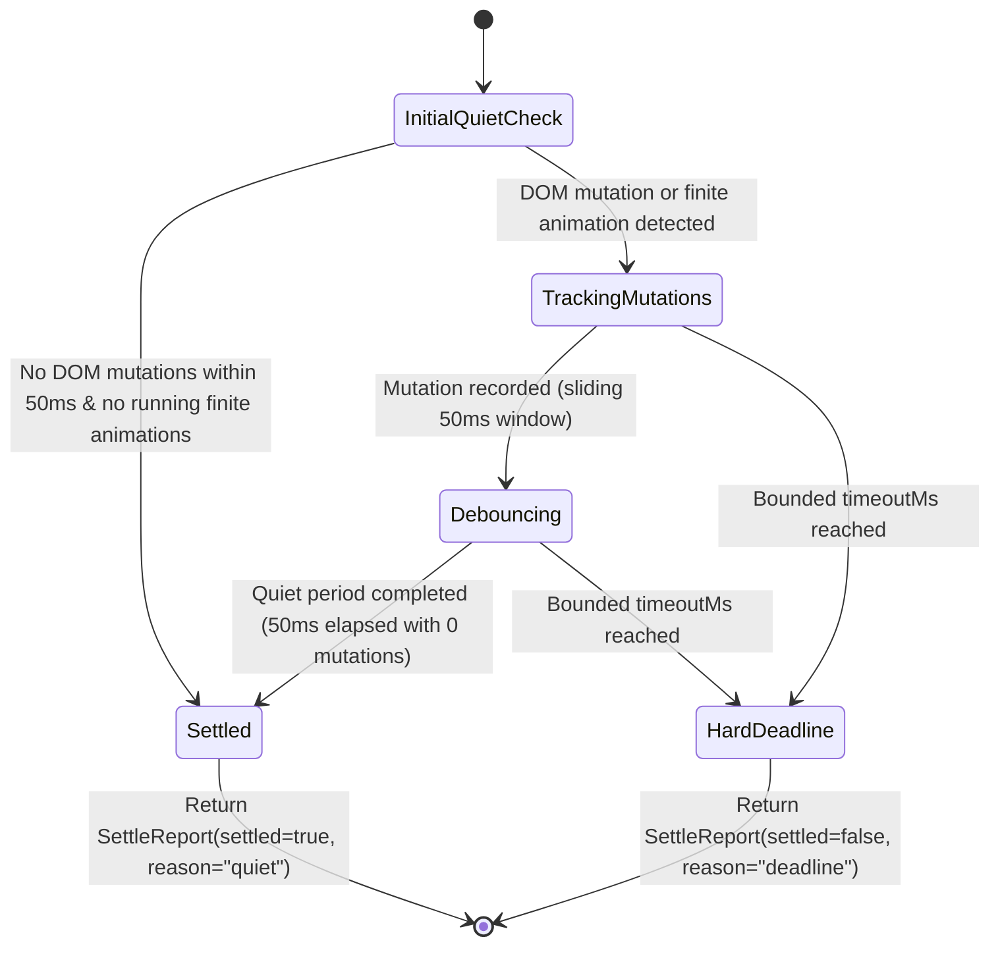

# Specification 04: Content Script DOM Engine, Census Snapshot & Element Registry

## 1. Content Script Architecture

The content script subsystem operates directly within web page contexts. It executes DOM observation, element accessibility indexing, atomic input dispatch, and 2D table matrix extraction.



---

## 2. Census DOM Snapshot Engine (`extension/content/snapshot.js`)

### 2.1 The `@e` Element Indexing Invariant
- Interactive nodes (links, buttons, inputs, selects, textareas, elements with `role` or click listeners) are indexed sequentially as `@e1`, `@e2`, `@e3`, etc.
- References using the deprecated `@ref` format are strictly forbidden and will fail schema validation.

### 2.2 Pruning & Token Trimming Rules
To keep agent prompt context small and token-efficient:
1. **Visibility Pruning**: Skip elements with:
   - `display: none`
   - `visibility: hidden`
   - `opacity: 0` (unless interactive child within)
   - Zero bounding client rect (`width === 0 && height === 0`)
   - `aria-hidden="true"`
2. **Text Compaction**: Collapse redundant whitespace, strip script/style tags, and truncate text nodes longer than 150 characters with `...`.
3. **Role & Attribute Normalization**: Emit accessible roles (`button`, `link`, `textbox`, `checkbox`, `combobox`) and essential states (`checked`, `disabled`, `expanded`, `selected`).

### 2.3 Output Representation Formats
The snapshot engine supports three output modes:
1. **Compact Census Text (Default)**: Single line per interactive element with `@e` token and reading label. Optimized for minimum token consumption.
2. **Structured Elements (`elements: true`)**: Flat JSON list of interactive element objects.
3. **Virtual Object Model Tree (`format: "vom"`, Opt-in)**: Hierarchical node tree with viewport-relative bounding boxes (`rect: {x, y, w, h}`), parentage (`parentId`, `depth`), and layer classification (`layer: "page" | "modal" | "mask"`). Used when layout or occlusion diagnosis is requested. Retains unified `@e` identifiers; bounded by `maxDepth` (default: 8) and `redactValues: true`.

---

## 3. 10-Step Atomic Setter Guard (`extension/content/setter.js`)

Modern reactive frameworks (React, Vue, Angular, Svelte) intercept standard `.value = val` assignments via custom prototype descriptors. To reliably trigger state synchronization without page corruption:

```javascript
export function setElementValue(element, value) {
  // 1. Focus element
  element.focus();

  // 2. Dispatch pointerdown / mousedown
  element.dispatchEvent(new PointerEvent("pointerdown", { bubbles: true }));
  element.dispatchEvent(new MouseEvent("mousedown", { bubbles: true }));

  // 3. Locate prototype setter to bypass framework proxies
  const prototype = Object.getPrototypeOf(element);
  const descriptor = Object.getOwnPropertyDescriptor(prototype, "value");
  if (descriptor && descriptor.set) {
    descriptor.set.call(element, value);
  } else {
    element.value = value;
  }

  // 4. Dispatch beforeinput
  element.dispatchEvent(new InputEvent("beforeinput", { bubbles: true, inputType: "insertText", data: value }));

  // 5. Dispatch input event (Crucial for React 16+)
  element.dispatchEvent(new Event("input", { bubbles: true, composed: true }));

  // 6. Dispatch change event
  element.dispatchEvent(new Event("change", { bubbles: true }));

  // 7. Dispatch pointerup / mouseup
  element.dispatchEvent(new PointerEvent("pointerup", { bubbles: true }));
  element.dispatchEvent(new MouseEvent("mouseup", { bubbles: true }));

  // 8. Dispatch blur / settle
  element.dispatchEvent(new Event("blur", { bubbles: true }));
}
```

---

## 4. Table Matrix Reconciler & CSV Injection Guard (`extension/content/table.js`)

### 4.1 2D Matrix Grid Algorithm
When extracting tables via `extract_table`, multi-row (`rowspan`) and multi-column (`colspan`) spans must be correctly reconciled into a normalized rectangular grid:
1. Initialize a dynamic 2D grid matrix `grid[row][col]`.
2. Iterate through each row `<tr>`.
3. Track active column index, skipping cells already occupied by previous `rowspan` declarations.
4. Fill all cells spanned by `colspan` and `rowspan` with the cell value.

### 4.2 CSV Formula Injection (CWE-1236) Invariant
Any cell string starting with a formula trigger character must be escaped by prepending an apostrophe (`'`):
```javascript
export function csv_safe(val) {
  if (val == null) return "";
  const s = String(val);
  if (/^[=+\-@\t\r]/.test(s)) {
    return "'" + s;
  }
  return s;
}
```

---

## 5. Multi-Frame Context Handling (`extension/content/frame_bridge.js`)

1. **Same-Origin iframes**:
   - Content script inspects `iframe.contentDocument` directly.
   - Assigns namespaced IDs: `@e12(iframe#login)`.
2. **Cross-Origin iframes**:
   - Direct DOM access is blocked by browser security sandbox.
   - The content script emits frame descriptor metadata (`frameId`, `src`, `rect`).
   - The tool dispatcher routes execution through CDP `driver/frame.js` using `Runtime.evaluate` targeted at the subframe's specific execution context ID.

---

## 6. Stabilization Finite State Machine (`wait_settle`)

### 6.1 Architecture & State Transitions
Page settling must never rely on passive mutation listeners or unbuffered `setTimeout` calls. The settling engine implements a strict Finite State Machine (FSM):



### 6.2 The Three Invariants of the Settle FSM
1. **Immediate Initial Debounce Invariant**:
   - When `wait_settle` begins, an active 50ms debounce timer is started immediately.
   - If the page is already quiet (0 mutations occur), the FSM transitions to `Settled` after 50ms instead of waiting for the full `timeoutMs` budget.
2. **Finite vs. Infinite Animation Invariant**:
   - SPA platforms (YouTube, Facebook, GitHub) continuously run infinite CSS keyframes (spinners, skeleton pulses, background ambient animations).
   - The FSM filters out all non-finite animations:
     ```javascript
     function isFiniteRunningAnimation(anim) {
       if (anim.playState !== "running") return false;
       if (anim.playbackRate <= 0) return false;
       const timing = anim.effect ? anim.effect.getTiming() : null;
       if (timing && timing.iterations === Infinity) return false;
       return true;
     }
     ```
   - Only finite user transitions or layout animations block the `settled` state.
3. **No-Throw Structured Contract**:
   - Reaching `timeoutMs` is a valid domain outcome, not an exceptional crash.
   - The FSM always resolves with a structured `SettleReport`:
     ```typescript
     interface SettleReport {
       settled: boolean;
       readyState: DocumentReadyState;
       waitedMs: number;
       mutationCount: number;
       activeAnimations: number;
       reason: "quiet" | "deadline";
     }
     ```

---

## 7. Deterministic Element Resolution Pipeline (`resolveTarget`)

### 7.1 Pipeline Stages
To prevent false-positive `ambiguous target` errors on responsive websites that duplicate DOM nodes for mobile/desktop layouts:

```
[Target Query: ref | css | text | role]
                 │
                 ▼
     Stage 1: DOM Connectivity
     Filter candidates: node.isConnected === true
                 │
                 ▼
     Stage 2: Strict Actionability & Visibility Filter
     Filter out elements with:
     - display === "none"
     - visibility === "hidden"
     - getBoundingClientRect() has width === 0 && height === 0
                 │
                 ▼
     Stage 3: Viewport Intersection Scoring
     Rank candidates:
     - Score 2: Visible & intersects viewport (top < window.innerHeight && bottom > 0)
     - Score 1: Visible but off-screen
                 │
                 ▼
     Stage 4: Cardinality & Disambiguation Guard
     - Count === 0 -> Throw ELEMENT_NOT_FOUND (-32002) with candidates/hints
     - Exactly 1 highest-scoring candidate -> Return target deterministically
     - >1 equally-ranked actionable candidates -> Throw AMBIGUOUS_TARGET with @e tokens
```

### 7.2 Disambiguation Exception Format
If and only if multiple elements pass Stages 1-3 with identical highest scores:
```json
{
  "code": -32003,
  "message": "ambiguous target \"input[name='search']\" matched 2 visible elements: @e57 <input> \"Search Wikipedia\", @e73 <input> \"Search Wikipedia\". Disambiguate with a ref, prefix (css=, text=, placeholder=), or a more specific string."
}
```
