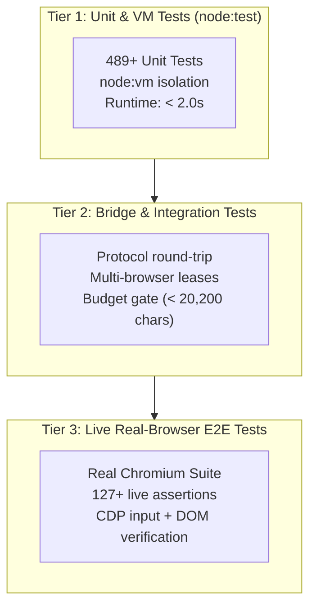

# Specification 05: Test Pyramid & Acceptance Criteria Matrix (ATDD)

## 1. Acceptance Test-Driven Development (ATDD) Model

Under the Spec-Driven development workflow, all implementations authored by the `dev-engineer` subagent must be independently verified by the `qa-test-engineer` subagent against the contracts defined herein.

No code change is deemed complete until it satisfies all three test tiers without regressions.



---

## 2. Acceptance Criteria Matrix by Subsystem

### 2.1 Protocol, Error Handling & Budget (`01-protocol-and-errors.md`)
| Test Case ID | Test Description | Expected Result | Edge Cases Covered |
| :--- | :--- | :--- | :--- |
| `TC-PROTO-01` | JSON-RPC 2.0 framing compliance | Request, response, and error objects strictly conform to JSON-RPC 2.0 spec. | Missing `id`, malformed JSON string, batch requests. |
| `TC-PROTO-02` | Standard `RpcError` taxonomy | All errors map to codes `-32700` to `-32010` with `data.reason` enum. | Unhandled JS exception wrapped into `-32603`, target not found into `-32001`. |
| `TC-PROTO-03` | Core Profile Token Budget | Consolidated tool descriptions and schemas for `core` profile `<= 20,200` characters. | Schema whitespace trimming, boundary threshold check (currently `13,311`). |
| `TC-PROTO-04` | In-flight request cancellation | `AbortSignal` interrupts pending CDP or bridge calls and cleans up timers. | Disconnection during in-flight network call, rapid double cancellation. |

### 2.2 CDP Driver & Low-Level Automation (`02-driver-and-cdp.md`)
| Test Case ID | Test Description | Expected Result | Edge Cases Covered |
| :--- | :--- | :--- | :--- |
| `TC-CDP-01` | Mouse wheel dispatch (`browser_wheel`) | Dispatches CDP `mouseWheel` event with `deltaX`, `deltaY`, coordinates, and modifier bitmasks. | Zero deltas, negative coordinates, combined Shift+Ctrl modifiers. |
| `TC-CDP-02` | Native drag-and-drop (`browser_drag`) | Smooth interpolation from source `(fromX, fromY)` to destination `(toX, toY)`. | Dragging to negative offsets, drag outside viewport boundaries. |
| `TC-CDP-03` | Device & environment emulation | Sets viewport, DPR, mobile UA, geolocation, dark mode; resets cleanly with `clear`/`off`. | Invalid geolocation coords, toggling dark mode without reloading page. |
| `TC-CDP-04` | RFC 6901 JSON Pointer | Traverses nested JSON, slices arrays, unescapes `~1` (`/`) and `~0` (`~`). | Root pointer `/`, nonexistent path segments, null intermediate objects. |
| `TC-CDP-05` | In-page network replay | Executes HTTP request inside page context reusing session cookies and headers. | CORS preflight handling, 401 unauthorized, binary response data. |

### 2.3 DOM Engine & Content Scripts (`04-content-and-dom.md`)
| Test Case ID | Test Description | Expected Result | Edge Cases Covered |
| :--- | :--- | :--- | :--- |
| `TC-DOM-01` | Census Snapshot `@e` indexing | Interactive elements indexed sequentially as `@e1`, `@e2`. `@ref` rejected. | Dynamic DOM additions, SVG elements, non-standard custom elements. |
| `TC-DOM-02` | Token pruning & trimming | Invisible elements (`display:none`, `visibility:hidden`, 0x0 rect) excluded. | Zero rect elements with visible children, opacity transitions. |
| `TC-DOM-03` | 10-Step Setter Guard | Form inputs populated reliably across React, Vue, Angular without stale state. | Controlled React input components, masked input fields, contenteditable. |
| `TC-DOM-04` | Table Matrix Reconciler | 2D matrix accurately maps rows/columns with complex `colspan` and `rowspan`. | Empty table cells, nested tables, mismatched column counts across rows. |
| `TC-DOM-05` | CSV Formula Injection Guard | Prepend apostrophe (`'`) to cell strings starting with `=`, `+`, `-`, `@`, `\t`, `\r`. | Pre-escaped cells, numeric formulas, strings with leading whitespace. |
| `TC-DOM-06` | Snapshot Format: Tree/VOM | Returns structured node hierarchy with `rect: {x, y, w, h}`, `parentId`, `depth`, `layer`. | Tree depth exceeding `maxDepth`, modal backdrops, `redactValues: true`. |

---

## 3. Verification Execution Pipeline

### 3.1 Pre-Commit Gate
The developer subagent and QA engineer must run the following commands sequentially:
```bash
# 1. Run all unit tests
npm test

# 2. Run release preflight gates
npm run preflight
```

### 3.2 Real Browser Acceptance Gate
When live browser verification is requested:
```bash
# Run core E2E suite against active Chrome bridge
node tests/e2e/run.mjs

# Run multi-frame E2E suite
node tests/e2e/run_multiframe.mjs

# Run rich-text editor E2E suite
node tests/e2e/run_editors.mjs

# Run extended tool suite (emulate, wheel, drag, download, network)
node tests/e2e/run_extended.mjs
```

---

## 4. Reporting Standards for QA Subagent

Every QA execution report must follow this format:
1. **Pass/Fail Counts**: Exact number of assertions passed, failed, and skipped.
2. **Execution Command**: The exact command executed.
3. **Edge Cases Covered**: Specific edge conditions tested.
4. **Edge Cases Left Out**: Boundary conditions intentionally deferred or unverified.
5. **Actionable Root Cause**: Detailed stack trace and failing invariant if any test fails.
